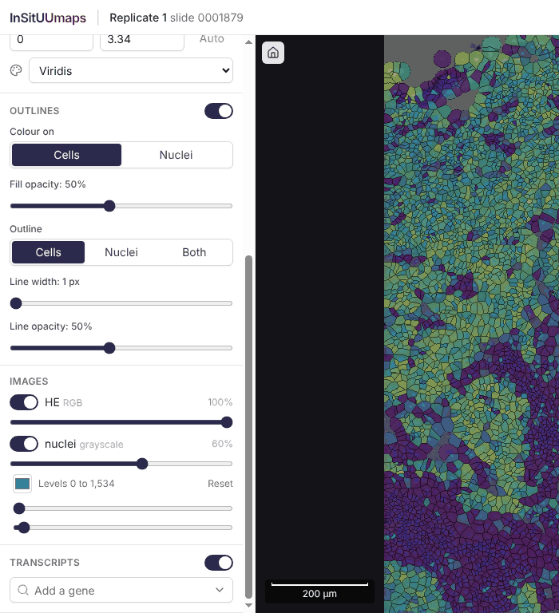
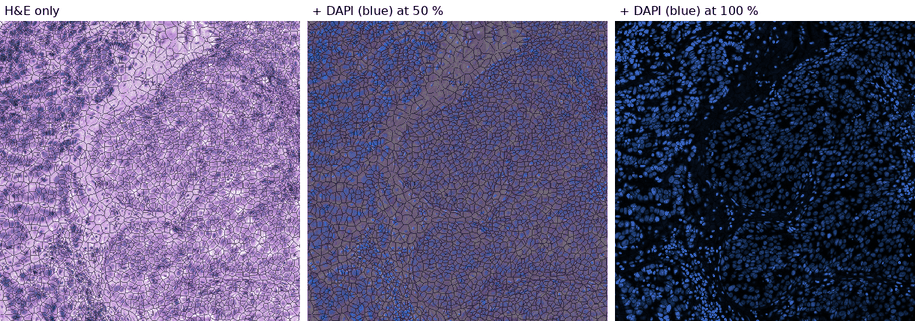
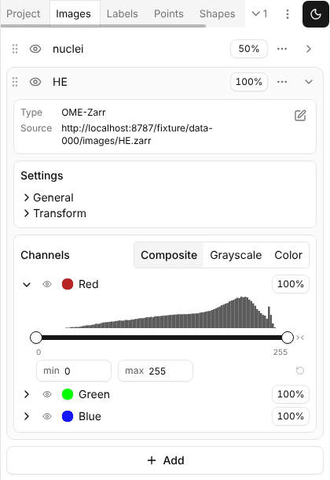

# Review: image layers and channel controls (task 6.3)

Design review, 2026-10-28, for JW to annotate with `JW:` lines. Nothing here is implemented.
Reviewed against `main` (`6829e76`) plus `feat/brand-accent` (PR #6, D26) for `index.css`,
`ui/controls.tsx` and `decisions.md`, and against upstream TissUUmaps `main` at `67de073`
(fetched with git; the GitHub API for the upstream repo was not reachable from the sandbox, so
PR discussions were not read, only branches and commits).

## 1. Verdict: go with changes

The task as written asks for a reorderable list of image layers that scales to dozens of
channels, with TissUUmaps' channel controls. Three parts of it do not hold as written:

1. **Dozens of channels do not need an order.** Within one multi-channel image the TissUUmaps
   renderer adds the channels up ("lighter" compositing over one black backdrop,
   `OpenSeadragonRendererBase.usesAdditiveBlending`). Addition is commutative, so the order of
   channels never changes the picture. Order only matters between **images** (each image is
   composited over what is below it). Drag-to-reorder belongs to a short list of images, not to
   the channel list.
2. **Today's model breaks with more than one fluorescence image, and no layer UI can fix
   that.** InSitUUmaps wraps every single-channel image as its own one-channel image (D20), so
   each gets its own opaque black backdrop. Two fluorescence images at 100 % therefore do not
   add up: the upper one hides the lower one completely, at 60 % it darkens it. With DAPI plus
   three Xenium stains, only the top stain is seen. The fix is in the model, not in the UI:
   **all fluorescence images of a sample that share a pixel grid become one multi-channel image
   ("Fluorescence") whose channels are the single images.** This is exactly the shape
   `ChannelSettingsWidget` is built for (composite / grayscale / colour, per-channel colour,
   levels, histogram, preview), so item 2 and this fix reinforce each other.
3. **Move into `@tissuumaps/react` (option b) is out of proportion now.** That package has no
   Tailwind, no Base UI and no theme today; moving the channel widgets means moving about 20
   files, adding a CSS/token story to a viewer package and rewiring `apps/tissuumaps`. That is an
   upstream architecture decision (a UI package), not a side effect of this task. Copy verbatim
   now (option a, as D25), offer the store-free refactor upstream as the first step towards b.

The blending issue of D20 is then mostly a crossfade: H&E (itself drawn as a 3-channel additive
image with a black backdrop) and the fluorescence layer are both opaque, so the top one at
opacity α shows `α · top + (1 - α) · bottom`. Reordering already gives the user the useful
choice; a hint makes it legible. A real "fluorescence spots on H&E" mode needs a core change
(section 4.4) and is proposed as a later prototype, not part of this work.

Everything else holds: keep reordering (between images), adopt the TissUUmaps channel
controls, keep the core workflow in the sidebar.

## 2. Current state

### 2.1 InSitUUmaps today



- `ui/Sidebar.tsx`, `ImagesSection` (line 553) and `GrayscaleControls` (line 609): one block per
  image in a fixed order (RGB first, then grayscale, each in `.ispy` order, from
  `insitupy/v2/project.ts:371`). Per image: `Switch`, opacity `Slider`; grayscale images add a
  native `<input type="color">`, black and white level sliders (two native ranges, no histogram)
  and _Reset_. One visible grayscale image costs about 160 px of sidebar height.
- State: `selection.images: Record<imageName, { visible, opacity, color?, contrast? }>`
  (`state/store.ts:445`), carried over between samples by image name. **Not in the URL**
  (`state/url.ts` writes source, sample, layer, color, mask only), although `ux.md` says the URL
  carries the state.
- Model: `viewer/model.ts:143` pushes one TissUUmaps `Image` per `ImageEntry` into the single
  `Sample` layer; draw order is array order (last on top). Grayscale images use the D20 wrapper
  (`viewer/grayscaleImage.ts`, data source type `insituumaps-grayscale`), which already computes
  a 512 x 512 px histogram per image (`getChannelHistogram`) that the UI does not show yet.
- Height at 1366 x 768 (measured, colouring _None_): sections start at Cell layer 56 px, Colour
  cells by 139, Outlines 244, Images 527, Transcripts 650. With a gene colouring the legend
  pushes Images below the fold (screenshot above is scrolled).

Blending today, fixture `data-000`, H&E with DAPI (blue) on top:



### 2.2 Stock TissUUmaps



- `ImagesPanel/index.tsx`: a dockview tab with a `SortableObjectList` (dnd-kit, drag handle,
  keyboard sortable, list shown topmost first via `useTopFirstSortable`). Each row: grip,
  `VisibilityButton` (eye), name (accordion trigger), `OpacityControl` (percentage button that
  opens a slider popover), a rename/delete menu, expand chevron. Expanded: `DataSourceWidget`,
  `ImageSettingsWidget` (General: layer select; Transform), `ChannelSettingsWidget`.
- `ChannelSettingsWidget`: view mode `ToggleGroup` (Composite / Grayscale / Color); in
  composite each channel row has an eye button (hover previews that channel alone), a
  `ColorPicker` swatch (Chrome picker from `@uiw/react-color-chrome`, merged as #261 /
  TMAP-379), name, `OpacityControl`; a row expands into `ContrastRangeWidget` (histogram with the
  selected range highlighted, two-thumb Base UI slider, min/max inputs, widen to data-type range,
  reset). In grayscale/color mode a radio group picks the one channel shown.
- Layer model: `Project.layers[]` (each with transform, visibility, opacity) and `images[]`,
  each image in one layer; images draw in array order. Multi-channel images (OME-Zarr with a `c`
  axis, including RGB H&E as R/G/B channels) draw additively over a black backdrop. A `YX` image
  is **not** multi-channel in stock TissUUmaps: it gets no channel controls and no levels at all
  (the reason for D20).
- No image colour maps / LUTs: a channel colour is a linear black-to-colour ramp; the palettes in
  `@tissuumaps/core` apply to data values only.

### 2.3 Upstream work (TissUUmaps/TissUUmaps)

| Ref                                                             | State (git)                                                                              | Relevance                                                                                                                                                                                                                                                                 |
| --------------------------------------------------------------- | ---------------------------------------------------------------------------------------- | ------------------------------------------------------------------------------------------------------------------------------------------------------------------------------------------------------------------------------------------------------------------------- |
| #312 `feat/viewer-toolbar`                                      | **merged** into `main` (`d6720ba`)                                                       | Viewer controls grouped in one floating toolbar (`ViewerToolbar.tsx`: home, point size popover, navigator toggle) with popovers. Also changes `ui/slider.tsx` (vertical orientation). Direction: viewer-level settings live in **popovers on the viewer**, not in panels. |
| #314 `feat/colorbar-viewer-control`                             | open, 57 commits, 4 behind `main`                                                        | Colorbars and scale bar as toolbar toggles plus viewer controls. Confirms the toolbar/popover direction; no image-channel UI.                                                                                                                                             |
| `feat/layerconfigs-ui`                                          | stale (last commit April 2026, 425 commits off an old base, still `@tissuumaps-viewer`)  | Not a basis; ignore.                                                                                                                                                                                                                                                      |
| `feat/project-panel-redesign`                                   | open, 4 ahead, 43 behind                                                                 | Project header, menu, render settings, welcome view. Touches the Project tab only; no image UI.                                                                                                                                                                           |
| `TMAP-379-...color-picker`                                      | content already in `main` (`color-picker.tsx` identical); branch not deleted             | The Chrome-based `ColorPicker` is the current upstream picker; copy it.                                                                                                                                                                                                   |
| `ImagesPanel/*`, `components/common/*`, `controls/ObjectList/*` | unchanged between the fork's `4c665b6` and upstream `main`, except new `icon-toggle.tsx` | Copies taken now stay current. `ui/slider.tsx` differs (vertical support from #312): take it from upstream `main`.                                                                                                                                                        |

Upstream is heading towards: object lists with eye + opacity button + drag handle per row,
details folded away, and viewer settings in popovers from a toolbar. The recommendation below
uses the same row design and the same popover idiom.

## 3. Data model check (item 5)

- `.ispy` `data.images` maps names to OME-Zarr paths; the app reads each into one `ImageEntry`
  (`insitupy/types.ts:71`: `name, pixelSize, rgb, size, window, dtypeMax, dataSource`). So the
  app has **one entry per stored image**, not per channel.
- InSituPy writes `rgb: true/false` and the original `axes` (`"SYX"` for H&E, `"YX"` for
  `nuclei`) into the image attributes (checked on the fixture). H&E is stored channel-first with
  an OME `c` axis and R/G/B omero channels.
- **Bug:** `project.ts:291` treats an image as RGB when `attrs.rgb === true` **or** it has a `c`
  axis **or** a 3-D shape. A `CYX` fluorescence stack (`rgb: false`) is therefore classified RGB:
  it renders through the stock multi-channel path with its omero colours, but the sidebar shows
  only a switch and opacity, no channel controls. Fix: if `attrs.rgb` is a boolean, trust it; use
  the axis/shape heuristic only when it is missing.
- Both InSituPy shapes are possible for fluorescence: several `YX` images (e.g. `nuclei` plus
  other stains) or one `CYX` image (e.g. a multi-stain `morphology_focus`). The layer model below
  handles both: a `CYX` image is one multi-channel layer as is (OME-Zarr provider, channel names
  from omero labels); compatible `YX` images are combined into one multi-channel layer by an app
  provider. Images on a different grid (pixel size or size differ) stay separate layers.
- No InSituPy change is blocking. Section 10 lists additions that make the result better
  (channel labels and windows for `CYX`, a stated `rgb` contract).

## 4. Options for item 1 (layer order and stacking)

All options assume the model change of section 1 (one fluorescence layer), so the layer list has
2 to 3 rows in practice (H&E, Fluorescence, rarely a second RGB image or an off-grid image), and
the channel list has 1 to dozens of rows.

### 4.1 Options

**A. Separate sidebar tab ("Cells | Images"), as TissUUmaps' Images tab.**

- Core workflow visible: no; while the user tunes DAPI levels the gene and legend are hidden, and
  switching gene vs. contrast is a frequent back-and-forth.
- 1366 x 768: fine (full 320 px x ~700 px for channels).
- Dozens of channels: good.
- Blending legible: as good as the list.
- Keyboard/touch: tabs are easy.
- Upstream: matches the dockview tab, but InSitUUmaps has no dockview.

**B. One floating window over the viewer for everything about images (layers and channels),
opened from a sidebar or toolbar button.**

- Core workflow visible: yes, but image visibility (H&E on/off, the most common image action)
  moves behind a click.
- 1366 x 768: a 300 px window covers a third of the 1046 px viewer.
- Dozens: good (own scroll).
- Upstream: matches the toolbar-popover direction (#312).
- Risk: a window that holds the whole image state is easy to lose; two places to look.

**C. Compact layer list in the sidebar, channel details in a floating panel per multi-channel
layer (recommended).** The Images section keeps one 36 px row per layer, built like TissUUmaps'
`SortableObjectListItem`: grip (drag and keyboard reorder), eye, name with a channel summary,
`OpacityControl`, and for multi-channel layers a _Channels_ button that opens a non-modal panel
docked to the left edge of the viewer, containing the verbatim `ChannelSettingsWidget`.

- Core workflow visible: yes; the section becomes shorter than today (two rows, about 90 px, vs.
  about 190 px with DAPI visible).
- 1366 x 768: panel 300 px wide, viewer keeps 746 px visible next to it; panel height
  `100vh - header - 16 px` with its own scroll.
- Dozens: the sidebar does not grow with channels; the panel scrolls; Grayscale/Color mode plus
  the radio group step through channels one at a time; hover preview isolates a channel.
- Blending: the order is visible in the list (top row = on top), a one-line hint explains the
  crossfade when an opaque layer covers another (section 4.4).
- Keyboard/touch: dnd-kit keyboard sorting on the grip (Space, arrows, Space; Escape cancels);
  all controls are Base UI buttons/sliders with labels; the panel closes on Escape and returns
  focus to the _Channels_ button. Touch: the grip has `touch-action: none` (dnd-kit), the
  opacity popover and sliders are Base UI (touch-ready); hover preview is pointer-only, which is
  acceptable because Grayscale/Color mode gives the same view by tap.
- Upstream: same row design as TissUUmaps' object lists; same popover idiom as #312.

**D. Inline accordion in the sidebar (expand a layer to see its channels).**

- Simplest, closest to TissUUmaps' panel. With 30 channels the sidebar grows by ~900 px and
  pushes Transcripts and overlays far down; expanded contrast widgets add ~100 px each. Good up
  to about 6 channels, not beyond.

**E. Order-free alternative: no reordering at all, fixed "H&E below, fluorescence above" with a
crossfade slider.** Smallest UI, but loses the stock ability JW wants to keep, and breaks as soon
as a second RGB image (IHC) exists.

### 4.2 Recommendation: C

C keeps every core-workflow decision in the sidebar, scales independently of the channel count,
and puts only the verbatim TissUUmaps widget in the new surface. D is the fallback if the floating
panel feels detached in the eye check (prototype scope in section 6.5).

### 4.3 Wireframe at 1366 x 768 (C, panel open)

```
+------------------------------------------------------------------------------------------------+
| InSitUUmaps | Replicate 1 slide 0001879                                       [Open]  [x]     | 44
+-------------------------------+------------------------------+---------------------------------+
| SAMPLE  [Replicate 1      v]  | CHANNELS  Fluorescence   [x] |                                 |
| CELL LAYER  [main][proseg]    | [Composite|Grayscale|Color]  |  [home] [...]   viewer          |
| COLOUR CELLS BY               | > (o) [#] DAPI         100%  |                                 |
|  [Gene|Cell property|None]    | v (o) [#] CD45         80%  |                                 |
|  Expression values [X     v]  |     .:||||||:..._______      |                                 |
|  Gene [EPCAM          x v]    |     o=========o        <>    |                                 |
|  [legend: 0 ====== 3.34]      |     min [120 ] max [2400] R  |                                 |
| OUTLINES                 (o)  | > (-) [#] E-cadherin   100%  |                                 |
|  Colour on [Cells|Nuclei]     | > (-) [#] 18S          100%  |                                 |
|  Fill opacity ----o---        | > (-) [#] aSMA/Vim     100%  |                                 |
|  Outline [Cells|Nuclei|Both]  |   ... scrolls ...            |                                 |
|  ...                          |                              |                                 |
| IMAGES                        |                              |                                 |
|  :: (o) Fluorescence 2/5 [100%] [Channels]                   |                                 |
|  :: (o) HE  RGB           [100%]                             |  [200 um]                       |
|  Fluorescence covers HE; lower its opacity to see HE.        |                      [navi]     |
| TRANSCRIPTS              (o)  |                              |                                 |
|  [Add a gene            v]    |                              |                                 |
+-------------------------------+------------------------------+---------------------------------+
   320 px sidebar (scrolls)       300 px floating panel          viewer remainder 746 px
:: grip (drag / keyboard)  (o)/(-) eye shown/hidden  [#] colour swatch (ColorPicker)
[100%] OpacityControl popover  R reset  <> widen to data type  > / v channel row collapsed/expanded
```

- The list shows the topmost layer first (TissUUmaps convention, `useTopFirstSortable`).
- An RGB layer has no _Channels_ button (its R/G/B channels are not offered).
- A layer with one channel (DAPI only) still opens the same panel; its summary reads `DAPI`.
- The hint line appears only when two visible layers overlap and the upper one is below 100 %
  or covers a visible layer (wording in section 6.3).

### 4.4 Blending

- Keep the "over" model: every image layer is opaque where it has content (RGB and fluorescence
  both have a black backdrop), so opacity is a crossfade with what is below. Reorder decides which
  one fades. This is predictable and needs no new controls.
- Make it legible: the list order (top row on top), the hint line, and the default (fluorescence
  hidden when an RGB image exists, as today).
- Not now: a core option per image, e.g. `background: "black" | "none"`, where `"none"` drops
  the backdrop and draws each channel with alpha proportional to its intensity, so fluorescence
  signal sits on H&E without darkening the rest. This is the mode pathologists ask for when they
  overlay IF on H&E, it is upstream-offerable (render package, `OpenSeadragonImageRenderer` data
  transfer), and it can only be judged by eye: prototype scope in section 6.5.

## 5. Component reuse (item 2): copy verbatim (a)

### 5.1 Decision

(a) now, with the upstream refactor of (b) offered in parallel.

| Criterion                    | (a) copy verbatim                                                                                                  | (b) move to `@tissuumaps/react`                                                                                                                                                         |
| ---------------------------- | ------------------------------------------------------------------------------------------------------------------ | --------------------------------------------------------------------------------------------------------------------------------------------------------------------------------------- |
| Effort                       | ~19 files copied, 2 shim modules, README table                                                                     | same files plus: Tailwind `@source` for the package in both apps, theme tokens contract, peer deps (Base UI, lucide, dnd-kit, @uiw), store-free props, all imports in `apps/tissuumaps` |
| Upstream value               | none directly                                                                                                      | high, but upstream has not decided on a UI package; `@tissuumaps/react` is the viewer component                                                                                         |
| Drift                        | low: files are unchanged upstream since `79f9480` (except `slider.tsx`); README pins the commit, re-copy to update | none                                                                                                                                                                                    |
| Changes in `apps/tissuumaps` | none                                                                                                               | every panel importing the moved files; risk of regressions in a repo we do not own                                                                                                      |
| Reversible                   | yes, the copies move mechanically later (D25 reasoning)                                                            | n/a                                                                                                                                                                                     |

`ChannelSettingsWidget` reads TissUUmaps' stores (`useProjectStore((s) => s.updateImage)`,
`useAppStore((s) => s.setImageChannelPreview)`). Keep it verbatim with two **shim modules** at
the import paths it expects, `src/stores/project.ts` and `src/stores/app.ts`, each a selector
hook over a tiny object (`updateImage(id, updates)`, `setImageChannelPreview(preview)`) that
forwards to the app store. Offer upstream, separately, a refactor that gives
`ChannelSettingsWidget` callbacks as props (`onImageChange`, `onChannelPreviewChange`); once
merged, re-copy and delete the shims. That refactor is also the first step of (b).

### 5.2 Files

Sync the fork's `main` with upstream `main` (3 commits, including #312) first, then copy from
there and pin that commit in `src/components/README.md`.

Copy verbatim (same relative path under `apps/insituumaps/src/`):

| File                                                         | Needed by                                  |
| ------------------------------------------------------------ | ------------------------------------------ |
| `components/panels/ImagesPanel/ChannelSettingsWidget.tsx`    | the channel panel                          |
| `components/panels/ImagesPanel/ContrastRangeWidget.tsx`      | ChannelSettingsWidget                      |
| `components/panels/ImagesPanel/channelViewMode.ts`           | ChannelSettingsWidget                      |
| `components/common/color-picker.tsx`                         | ChannelSettingsWidget                      |
| `components/common/opacity-control.tsx`                      | channel rows, layer rows                   |
| `components/common/visibility-button.tsx`                    | channel rows, layer rows                   |
| `components/common/collapsible.tsx`                          | channel rows                               |
| `components/common/fieldset.tsx`                             | ChannelSettingsWidget                      |
| `components/common/accordion.tsx`                            | layer list (as `ObjectList`)               |
| `components/ui/popover.tsx`                                  | ColorPicker, OpacityControl, channel panel |
| `components/ui/radio-group.tsx`                              | grayscale/colour mode                      |
| `components/ui/toggle-group.tsx`, `components/ui/toggle.tsx` | view mode                                  |
| `components/ui/slider.tsx` (from upstream `main`)            | OpacityControl, ContrastRangeWidget        |
| `components/controls/ObjectList/useTopFirstSortable.ts`      | layer list                                 |
| `lib/format.ts`                                              | OpacityControl (`percentFormat`)           |
| `react-color.css` (+ its `@import` in `index.css`)           | ColorPicker                                |

Already present and identical: `icon-button.tsx`, `button.tsx`, `input.tsx`, `input-group.tsx`,
`tooltip.tsx`.

New dependencies, all already in the lockfile through `apps/tissuumaps` (D2 holds):
`@dnd-kit/react`, `@uiw/react-color-chrome`, `@uiw/color-convert`.

Not copied, and why:

- `ImagesPanel/index.tsx`: add-image button, data-source editor, rename/delete; InSitUUmaps data
  is read-only and comes from `.ispy`.
- `ImageSettingsWidget.tsx`, `category.ts`: layer select and transform; the app has one layer and
  transforms come from the pixel size (D4).
- `ObjectList/ObjectListItem.tsx`, `ObjectListItemMenu.tsx`: the row requires rename/delete and
  pulls confirm/prompt dialogs and the dropdown menu. The app builds its row from the same parts
  (accordion header, grip with `useSortable`, `VisibilityButton`, `OpacityControl`) in
  `ui/images/ImageLayerList.tsx`, ~60 lines. Upstream offer: make `onRename`/`onDelete`
  optional so the menu disappears, then the row could be copied too.

### 5.3 Image colour maps (LUTs)

Worth a core addition later, not now: an optional `colorMap` on `ImageChannel` (a palette id
from `@tissuumaps/core`) applied in the channel data transfer instead of the black-to-colour
ramp. It helps dim signal in the Grayscale/Color single-channel views ("fire", viridis); in
composite (additive) mode LUTs mix badly, so it should apply to single-channel views only.
Upstream-offerable; low priority.

## 6. Implementation plan

Two PRs for this work, one follow-up for the controls list (section 7).

### 6.1 PR 1: image layer model (no new UI yet)

1. `insitupy/v2/project.ts` `readImages`: trust `attrs.rgb` when it is a boolean; read omero
   channel labels and windows for every channel of a `CYX` image into `ImageEntry`
   (new `channels?: { name: string; window?: [number, number]; color?: string }[]`). Keep the
   order of `.ispy`; drop the RGB-first sort there (ordering moves to step 3).
2. `viewer/imageLayers.ts` (new, pure): `groupImageLayers(images: ImageEntry[]): ImageLayer[]`,
   where `ImageLayer = { id, name, kind: "rgb" | "fluorescence", channels: { key, name, image,
index? }[], pixelSize, size }`. Rules: RGB image = own layer (`id: "rgb:<name>"`); `CYX` image
   = own layer with its channels; all `YX` images with the same pixel size and size = one layer
   `"fluorescence"` named _Fluorescence_ (or the image name if there is only one); off-grid `YX`
   images get their own layer. Channel keys are stable strings (`<image>` for `YX`,
   `<image>/<label or index>` for `CYX`), used for settings, URL and carry-over between samples.
3. `viewer/grayscaleImage.ts` → generalise the provider to N channels
   (`insituumaps-channel-stack`): its data source lists the single-channel sources; `getSizeC()`
   returns N, `getTileSource(c)` and `getTileData` delegate to channel `c`, histograms and
   data-type ranges per channel, `getChannelName(c)` from the layer. Histograms are computed per
   channel on first `getChannelHistogram(c)` call, not all at open (dozens of channels).
4. `state/store.ts` `Selection`: replace `images` with
   `imageOrder: string[]` (layer ids, bottom to top), `imageLayers: Record<layerId, { visible,
opacity, viewMode, activeChannel }>`, `channels: Record<channelKey, { visible, opacity?,
color?, contrast? }>`; add transient `channelPreview: { layerId, channelIndex } | null` (not
   carried, not in the URL). Actions `moveImageLayer(id, newIndex)`, `setImageLayer`,
   `setChannel`, `setChannelPreview`. Defaults: order RGB layers below fluorescence (as today);
   fluorescence layer hidden when an RGB layer exists; in the fluorescence layer the first
   channel visible, the others hidden when there are more than 4 (dozens of visible channels
   would load dozens of tile sets at open). Carry settings over between samples by layer id and
   channel key; layers missing in the new sample are dropped from the order, new ones inserted by
   the default rule.
5. `viewer/model.ts`: build `model.images` in `imageOrder`; RGB layers unchanged; channel layers
   use the stack data source with `channels[]`, `channelViewMode`, `activeChannel` from the
   selection; apply `channelPreview` last (`channelViewMode: "grayscale"`, `activeChannel` =
   previewed index), exactly as `apps/tissuumaps/src/components/panels/ViewerPanel/index.tsx:36`
   does.
6. `state/url.ts`: add image state (format to be confirmed, Q4): `img=` the visible layers
   top to bottom with opacity, e.g. `img=fluorescence:80,HE`; `ch=` the visible channels of
   channel layers with colour and levels, e.g. `ch=nuclei:3b82f6:0-1534,CD45:ff0000:120-2400`;
   `chmode=grayscale:CD45` for the single-channel modes. Unknown names are ignored; without the
   parameters the defaults of step 4 apply (old links keep working).
7. `ui/Sidebar.tsx`: adapt the current `ImagesSection` to the new state (one block per layer,
   multi-channel layers list their channels with today's controls) so PR 1 stays shippable;
   PR 2 replaces it.
8. `scripts/fixture.mjs` / `convert_project.py` (demo only, like `main-copy`): add a second `YX`
   fluorescence image to `data-001` (e.g. a blurred or inverted copy of `nuclei` named
   `boundary`) and a `CYX` stack `morphology_stack` of both, so grouping and multi-channel UI are
   testable on the fixture.
9. `docs/decisions.md`: D27 (fluorescence images combined into one additive layer; order between
   layers only; channel panel; verbatim copy with shims); update D20 (wrapper generalised; the
   "darkens by its opacity" remark becomes "crossfade, see D27"), D10 (superseded for images),
   `ux.md` (Images principle, URL list), README user step 5.

### 6.2 PR 2: TissUUmaps channel controls and the layer list

1. Copy the files of section 5.2; add the shims `src/stores/project.ts` and `src/stores/app.ts`;
   extend `src/components/README.md` (table, commit pin, "shims" paragraph); import
   `react-color.css`.
2. `ui/images/ImageLayerList.tsx`: `DragDropProvider` + `useTopFirstSortable` + accordion rows
   (grip, `VisibilityButton`, name and channel summary, `OpacityControl`, _Channels_ button for
   channel layers). Names from the data (D-principle: no ids).
3. `ui/images/ChannelPanel.tsx`: a Base UI `Popover` (copied `popover.tsx`) anchored to the
   viewer's left edge, non-modal, not dismissed by pointer events in the viewer (pan/zoom while
   tuning), closed by its close button, Escape or the _Channels_ button; contains the verbatim
   `ChannelSettingsWidget` with `image` = the TissUUmaps `Image` built in `viewer/model.ts` and
   `data` = the loaded stack `ImageData`. The UI needs that `ImageData` instance: expose it from
   `viewer/loaders.ts` (cache by data source, the same instance the renderer uses) through the
   store once loaded; show a spinner row until then.
4. Shim `updateImage(id, updates)`: maps `updates.channels[i]` to `setChannel(channelKey(i))`,
   `updates.channelViewMode`/`activeChannel` to `setImageLayer`; `setImageChannelPreview` to
   `setChannelPreview`.
5. Hint line under the list (section 6.3). Remove `GrayscaleControls` and the image `Switch`es.
6. Smoke test and vitest additions (section 8); screenshots for the eye check.

Effort: PR 1 about 1.5 days, PR 2 about 1.5 days.

### 6.3 Edge cases and risks

- **URL length** with many visible channels: only visible channels are written; with 40 visible
  channels the URL is ~1.5 kB, fine for browsers and chat apps.
- **D19** (one colouring at a time) is untouched; images are not colourings.
- **D20**: the single-channel wrapper becomes the N-channel stack; one backdrop per layer instead
  of one per image. Visual change: two fluorescence images now add up instead of hiding each
  other. Note it in the changeset.
- **Hint wording**: "Fluorescence covers HE; lower its opacity to see HE through it." shown
  when an upper visible layer covers a lower visible layer; "Drag a layer to change which is on
  top." once per session when the user first lowers the top layer's opacity (or simply always
  under the list, Q7).
- **Performance with dozens of channels**: one OpenSeadragon `TiledImage` per channel.
  OpenSeadragon does not load tiles of a tiled image at opacity 0 (`TiledImage.getDrawArea` returns false without preload), so hidden
  channels cost only their metadata read at open (already done in `readImages`) and, lazily, the
  histogram. Visible channels each load their tiles: many visible channels at low zoom is
  bandwidth-bound; the default (step 4) keeps the first view cheap. Check the core tile cache
  isolation (D-core fix) with ~30 tiled images in PR 1.
- **Drag-and-drop accessibility**: dnd-kit's keyboard sensor and live-region announcements on the
  grip (`aria-label="Reorder <name>"`, as TissUUmaps); with 2 to 3 rows this is enough. Touch:
  handle-only drag, no long-press needed.
- **Grid mismatch**: `YX` images of one sample on different grids (e.g. an unregistered IF scan)
  stay separate layers; then the old stacking behaviour applies between them, which the order
  and hint make visible.
- **RGB `ContrastRangeWidget`**: not offered for RGB layers (R/G/B levels on H&E are rarely
  wanted and the stock list would show three colour channels).
- **Channel names** of `CYX` without omero labels: `Channel 0..n` (stock fallback); request labels
  from InSituPy (section 10).
- **Copies vs. app tokens**: the copied widgets use `--primary`, `--ring`, `--input`, `--muted`
  (present since D25/D26); the histogram uses `fill-primary/70` = navy, fine.

### 6.4 Not in scope

Cells, outlines, transcripts, dark theme, accent values, LUTs, the background-free blend mode.

### 6.5 Prototype scope (only if JW wants evidence before PR 2)

- Panel vs. inline (C vs. D): a throwaway branch with both variants on the fixture's demo
  channels, screenshots at 1366 x 768 and a tablet width; half a day.
- Background-free fluorescence (section 4.4): in a branch, a `background: "none"` option in
  `OpenSeadragonImageRenderer` (no backdrop, `source-over` with alpha = normalised intensity);
  compare with the crossfade on H&E + DAPI by eye; half a day.

## 7. Duplication list (item 3)

App controls from `ui/controls.tsx` (D10) and native inputs, against TissUUmaps components.
"Now" = with this work (PR 1/2), "later" = a follow-up "controls convergence" PR, "keep" = no
TissUUmaps counterpart worth taking.

| App control / use                                                                                     | TissUUmaps counterpart                                        | Recommendation                                                                                                                  | Accessibility                                                                                                                                                                                                                                                                                                                                            |
| ----------------------------------------------------------------------------------------------------- | ------------------------------------------------------------- | ------------------------------------------------------------------------------------------------------------------------------- | -------------------------------------------------------------------------------------------------------------------------------------------------------------------------------------------------------------------------------------------------------------------------------------------------------------------------------------------------------- |
| `Switch`, images (Sidebar 571)                                                                        | `VisibilityButton` (eye)                                      | **Now**: replaced by the layer rows                                                                                             | Eye button has a name ("Hide image HE") and a visible icon state.                                                                                                                                                                                                                                                                                        |
| `Switch`, section switches: Outlines 469, Transcripts 693, each annotation/region 788                 | `components/ui/switch.tsx` (Base UI)                          | **Later**, with the contrast fix below                                                                                          | App off track `bg-zinc-300` is 1.5:1 on white; the TissUUmaps off track `bg-input` (`oklch(0.922 0 0)`) is about **1.25:1**, worse, so adopting it alone does not solve it. Fix: off track in a ≥ 3:1 grey (`bg-zinc-500`, 4.8:1, or `bg-muted-foreground`, 4.7:1) with the white thumb; offer the same upstream (`data-unchecked:bg-muted-foreground`). |
| `Slider`, image opacity (Sidebar 588)                                                                 | `OpacityControl`                                              | **Now**                                                                                                                         | Popover button with a name and value ("Opacity of HE 100%"); Base UI slider with keyboard steps.                                                                                                                                                                                                                                                         |
| `Slider`, black/white levels (644, 654) + native `type="color"` (624) + _Reset_                       | `ContrastRangeWidget`, `ColorPicker`                          | **Now**                                                                                                                         | Two-thumb slider with thumb labels "Minimum"/"Maximum", typed min/max, labelled reset; ColorPicker has hex input (typing a colour works without a pointer).                                                                                                                                                                                              |
| `Slider`, fill opacity 490, line width 524, line opacity 537, point size 752                          | `components/ui/slider.tsx`                                    | **Later** (copied now anyway); fill and line opacity could become `OpacityControl` to save height                               | Native range is accessible; Base UI adds thumb labels and a larger thumb (16 px). Track `bg-input` is low contrast, the filled part and thumb are navy (pass).                                                                                                                                                                                           |
| `SegmentedControl`: cell layer 107, colour cells by, colour on, outline (Sidebar 254 ff.)             | `components/ui/toggle-group.tsx`                              | **Later** (copied now)                                                                                                          | App control declares `role="radiogroup"` but has no arrow-key navigation or roving tab index, so it is a set of tab stops posing as a radio group. Base UI ToggleGroup has roving focus and arrow keys. Adopting it fixes this.                                                                                                                          |
| `Select` (native): sample 69, cell layer (many) 117, expression values 237, property 287, palette 344 | `components/common/simple-select.tsx` (Base UI)               | **Later** for palette (can show gradients, like TissUUmaps' map selects); **keep** native for the others until a reason appears | Native select is the most robust on touch and screen readers; SimpleSelect is fine too. For 100 samples the sample picker would be better as the copied `Autocomplete` (later).                                                                                                                                                                          |
| `Button`: Header 34/63/70, StartScreen 84/105, Sidebar 60/333/363/369, SampleBrowser 110/173          | `components/ui/button.tsx` (already copied, D25)              | **Later**, mechanical                                                                                                           | Both have focus-visible outlines (D26 for the app). Copied button uses `--ring` rings.                                                                                                                                                                                                                                                                   |
| `TextInput`: StartScreen 76 (URL), SampleBrowser 100 (filter)                                         | `components/ui/input.tsx` (already copied)                    | **Later**, mechanical                                                                                                           | Copied input border `border-input` is 1.25:1 (same issue as the switch); app input `border-zinc-300` 1.5:1. Both below 3:1; see Q8.                                                                                                                                                                                                                      |
| Range min/max inputs of the legend (Sidebar ~417, `RangeInput`)                                       | `ContrastLimitInput` pattern (`InputGroup` with addon)        | **Later**                                                                                                                       | Same commit-on-blur/Enter behaviour already; addon gives a visible label.                                                                                                                                                                                                                                                                                |
| Native `type="color"`, transcript genes (Sidebar 717)                                                 | `ColorPicker`                                                 | **Later** (after PR 2 brings it)                                                                                                | Native picker is accessible but looks different per OS; one picker in the app.                                                                                                                                                                                                                                                                           |
| Native checkbox, category list (Legend 58)                                                            | `components/ui/checkbox.tsx`                                  | **Later**                                                                                                                       | Native checkbox with `accent-primary` is fine.                                                                                                                                                                                                                                                                                                           |
| `Section`, `Label`, `Hint`                                                                            | `Fieldset`/`FieldsetLegend`, `Field`/`FieldLabel` (`common/`) | **Keep** for now; consider with the Select change                                                                               | `Label` is a `<label htmlFor>`; OK. Section headings are `<h2>`, good for screen-reader navigation, better than a legend here.                                                                                                                                                                                                                           |
| `Spinner`                                                                                             | none                                                          | **Keep**                                                                                                                        | `aria-hidden`; loading text is next to it.                                                                                                                                                                                                                                                                                                               |
| Remove buttons of transcript genes (Sidebar 740, plain `button` with `aria-label`)                    | `IconButton` (already copied)                                 | **Later**                                                                                                                       | IconButton adds a tooltip with the same label.                                                                                                                                                                                                                                                                                                           |

## 8. Tests

### 8.1 vitest

- `viewer/imageLayers.test.ts`: H&E (`rgb: true`) + `nuclei` + `boundary` (`YX`, same grid) gives
  `[rgb:HE, fluorescence(nuclei, boundary)]`; a `YX` image with another pixel size becomes its own
  layer; a `CYX` image with `rgb: false` becomes one layer with one channel per label.
- `insitupy/v2/project.test.ts`: `rgb: false` with a `c` axis is not RGB; channel labels and
  windows read from omero.
- `viewer/model.test.ts` (new): the order of `model.images` follows `imageOrder` (this is what
  the renderer draws); channel settings land in `channels[i]` (visibility, colour, contrast);
  a hidden layer has `visibility: false`; `channelPreview` sets grayscale + `activeChannel` in
  the model without touching the selection.
- `state/url.test.ts` (new): `img=`/`ch=`/`chmode=` round trip through `writeStateToUrl` and
  `readStateFromUrl`; unknown layer or channel names are dropped; links without them yield the
  defaults.
- `state/store.test.ts`: carry-over between samples by layer id/channel key; new layers inserted
  by the default rule; `moveImageLayer` bounds.
- The stack provider: `getSizeC`, `getTileSource(c)` delegation and lazy histograms with stub
  inner providers.

### 8.2 Smoke test (`scripts/smoke-test.mjs`, fixture with the demo channels)

1. Open `data-001`: the Images list shows _Fluorescence_ above _HE_ (DOM order) and the model's
   image order matches (`window.insituumaps`).
2. Show Fluorescence at 100 %: a viewer region is dark (`regionStats` mean below a threshold);
   reorder with the keyboard on the grip (focus, Space, ArrowDown, Space): the model order flips
   and the region turns bright (H&E on top). This is the "order reaches the renderer" check.
3. Open the channel panel, hide `nuclei`, show `boundary`: model channel visibility follows;
   type a max level and press Enter: model contrast limits follow.
4. Copy the URL, reload: order, opacity, visible channels, colours and levels are restored.
5. Switch sample and back: settings carried by name.
6. Screenshots `0x-images-panel.png` at 1366 x 768 for the eye check.

### 8.3 By eye (JW)

- 1366 x 768: core workflow and Images rows visible together; panel does not hide what you tune.
- Drag feel with mouse and on a touch screen; keyboard reorder with a screen reader announcement.
- Histogram readability for DAPI (sparse tails) and for a dim stain.
- Hover preview and Grayscale/Color stepping through 5+ channels.
- The hint wording and when it appears; the crossfade of Fluorescence over H&E.
- Two fluorescence channels now add up (before: the top one hid the other).

## 9. Acceptance criteria

1. The Images section lists one row per image layer, topmost first; each row has a drag handle
   that also works with the keyboard, an eye button, the name and an opacity button.
2. All fluorescence images of a sample on one pixel grid form one layer whose visible channels
   add up; a `CYX` stack is one layer with its channels; RGB images have no channel controls.
3. The channel panel uses the verbatim TissUUmaps `ChannelSettingsWidget` (view modes, colour
   picker, histogram contrast, preview on hover); it opens next to the sidebar, the viewer stays
   interactive, Escape closes it and returns focus.
4. Layer order, layer visibility/opacity and visible-channel settings reach the renderer (model
   order and canvas check in the smoke test) and round-trip through the URL.
5. At 1366 x 768 the sidebar from Sample to Images fits without the Images section growing with
   the channel count.
6. `src/components/README.md` lists every new copy with its upstream path and commit, and the
   shims; no copied file differs from upstream.
7. `pnpm typecheck && pnpm lint`, vitest and both smoke tests pass; D27 and the D20/D10/ux.md
   updates are written.

## 10. Proposed additions to `docs/insitupy-changes.md`

### 7. Image kind and channel metadata (nice to have)

**Problem.** The viewer decides RGB vs. fluorescence from the `rgb` attribute InSituPy writes
today (`rgb: true` for H&E, `false` for `nuclei`), falling back to a heuristic on the axes. A
multi-channel fluorescence stack (`CYX`) needs channel names and windows to be usable.

**Request.** (a) Keep writing `rgb` (boolean) for every image, and say so in the format
description, so readers can rely on it. (b) For a `CYX` image, write the omero `channels[i].label`
(stain name, e.g. `DAPI`, `CD45`) and `channels[i].window` (as item 5, per channel), and a
`color` when a natural one exists. (c) Images of one sample that are registered to each other
share the pixel size and size (already the case for Xenium morphology images and registered
IF), so the viewer can draw them as one additive layer; an image that is not registered should
carry a different pixel grid or a flag (e.g. `registered: false`), never the same grid.

**Writer affected.** `ImageData.save` / `write_zarr` (omero section).

**Converter.** None needed; the viewer falls back to `Channel n` names and the full data range.

## 11. Open questions

Each with my recommendation; one `JW:` line each.

1. **Fluorescence grouping.** Combine all `YX` fluorescence images on one grid into one additive
   layer (section 1)? Recommendation: yes, always; no per-sample opt-out.
   JW:
2. **Channel panel vs. inline.** Always open channels in the floating panel (C), even for a
   single channel? Recommendation: yes, one behaviour; switch to inline (D) only if the eye check
   of the prototype prefers it.
   JW:
3. **Shims vs. upstream-first refactor.** Keep `ChannelSettingsWidget` verbatim with two shim
   modules now, and offer the props refactor upstream in parallel? Recommendation: yes.
   JW:
4. **URL format.** Carry order, layer visibility/opacity, and visible channels with colour and
   levels (`img=`, `ch=`, `chmode=`)? Recommendation: yes; hidden channels and defaults stay out.
   JW:
5. **Default order and visibility.** Fluorescence above H&E, hidden when an RGB image exists;
   in a fluorescence layer with more than 4 channels only the first one visible at open?
   Recommendation: yes.
   JW:
6. **Blending.** No blend-model change now (crossfade plus hint), and a later half-day prototype
   of a background-free fluorescence mode in the render package? Recommendation: yes.
   JW:
7. **Hint visibility.** Show the crossfade hint only when one visible layer covers another,
   or always as a static line under the list? Recommendation: only when it applies.
   JW:
8. **Control boundary contrast.** Fix the off switch with a ≥ 3:1 track (`bg-zinc-500`, or the
   TissUUmaps switch with `data-unchecked:bg-muted-foreground`) in the controls follow-up, and
   separately raise `--input` (input and slider borders, now 1.25:1) to about `oklch(0.62 0 0)`
   (3.6:1)? Recommendation: switch fix yes; `--input` change yes, but in its own small PR with a
   screenshot, since it darkens every input border, and offered upstream.
   JW:
9. **Fork sync.** Merge upstream `main` (3 commits, incl. #312) into the fork before copying,
   so `slider.tsx` is current? Recommendation: yes, as the first commit of PR 2 (or its own PR).
   JW:
10. **Demo channels in the fixture.** Add a second `YX` image and a `CYX` stack to `data-001`
    (demo only, like `main-copy`) for tests? Recommendation: yes.
    JW:
11. **LUTs.** Note image colour maps as a later, upstream-offerable core addition for
    single-channel views, not planned now? Recommendation: yes.
    JW:
12. **Duplication list.** Do the "later" items of section 7 as one "controls convergence" PR right
    after PR 2? Recommendation: yes, except `Select` (keep native).
    JW:
