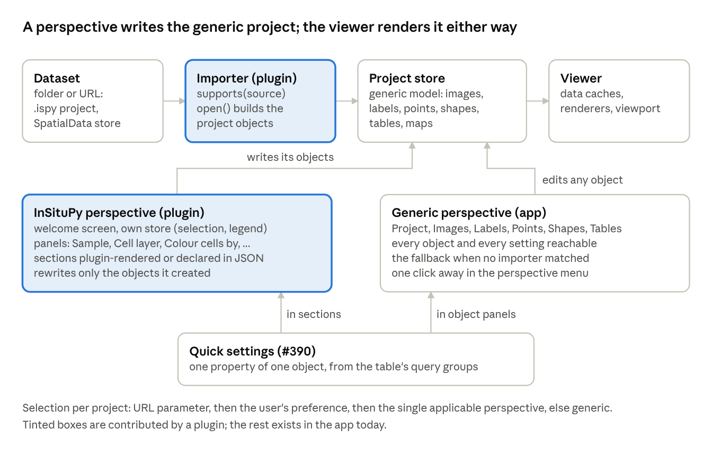
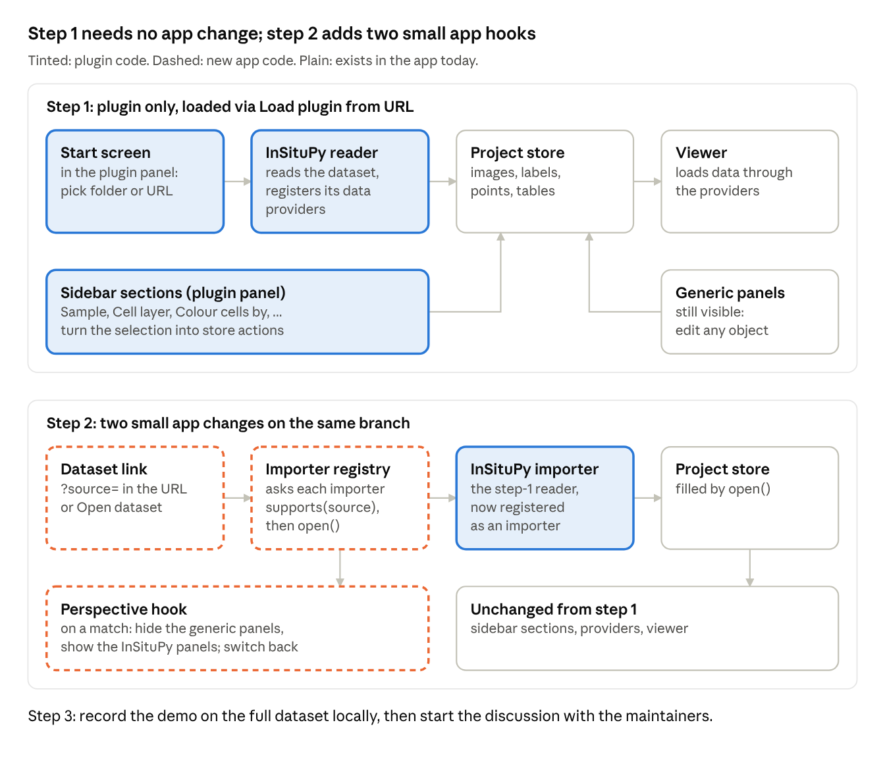

# Layouts for TissUUmaps: design strategy

Nov 3, 2026 · Johannes Wirth  
Exported from the Claude doc "Layouts for TissUUmaps: design strategy": https://claude.ai/artifact/WXMb6uivHgmBz2yvh4RXk4 (the doc is the living version).

## 1. Summary

Recommendation: do not build a monolithic "layout" feature. Split the idea into three upstream mechanisms that are each small, each useful on their own, and that together give exactly what InSitUUmaps does today: (1) **project importers**, which open a dataset folder or URL that is not a `.tm4` and build the generic project from it (this is also what the still empty SpatialData plugin needs); (2) **quick settings** (#390), which give a simplified control over one object property driven by the table's query groups; (3) a **lens** (my name suggestion for "layout"), a plugin contribution that hides the generic panels, adds its own panels and start screen, and is offered when an importer recognised the data. The generic SpatialData-shaped project stays underneath in every case, because a lens only writes the project store; switching back to the generic lens shows the very objects it built.

Main reasons:

- **Upstream fit.** The plugin contract today is `id`, `name`, `setup`, `mount` and nothing else (`packages/@tissuumaps-core/src/types/plugins.ts:27-79`). The app builds a fixed Dockview layout in `App.tsx:172-227` and only lets plugins add one panel next to the Project tab (`usePluginPanels.ts:25-69`). Three narrow hooks (importer registry, lens registry, quick settings) are the minimum that lets a plugin do what `apps/insituumaps` does, and each can be a separate PR.
- **Reuse of the fork.** InSitUUmaps already builds a TissUUmaps project in memory from InSituPy data (`apps/insituumaps/src/viewer/model.ts:122-325`) and already separates data access (`src/insitupy/`), selection state (`src/viewer/selection.ts`) and UI (`src/ui/`). Those become the InSituPy importer, the lens's own store, and the lens's panels, with the UI mounted the way `docs/development/plugins.md:285-296` already describes for React.
- **Quick settings are the right building block, not a competitor.** The fork's "Colour cells by" section (expression source, then gene, or a cell property) is a two-level query group over one labels object, which is what #390 proposes. A lens should instantiate quick settings with fixed targets and names instead of re-implementing column pickers.
- **Detection is cheap and reliable.** An InSituPy project is a folder with a `.ispy` JSON file (`insitupy/_constants.py:63`), an experiment a folder with `metadata.parquet` or `metadata.csv` and `data-NNN/` sample folders, and InSituPy's SpatialData export carries `attrs["insitupy_spatialdata_dialect"]`. All three can be checked with one small request, like data providers already do in `DataProvider.supports` (`storage/base.ts:195-199`).
- **Declarative layouts are possible, but only as a recombination of these blocks.** A JSON lens can pick panels, sections, targets, defaults and wording. Anything that computes (nucleus-to-cell remapping, transcript tiles, legends, picking, sample tables) needs a plugin.

What I verified against the code is cited as `path:line`; upstream paths refer to `TissUUmaps/TissUUmaps` at commit `67de073` (2026-10-28), fork paths to `SpatialPathology/insituumaps` at `da0165c`, InSituPy to `9857e57`. Inferences are marked as such.

## 2. Current state

### 2.1 Upstream TissUUmaps 4

The viewer is organised by generic data kinds. The project model holds layers, images, labels, points, shapes, tables, five group-to-value maps and viewer options (`packages/@tissuumaps-core/src/model/project.ts:15-67`, `docs/concepts/data-model.md:7-11`). The app shows one Dockview panel per kind next to a locked viewer panel: Project, Images, Labels, Points, Shapes, Tables (`apps/tissuumaps/src/App.tsx:172-227`, IDs in `panels.ts:2-10`). Each object panel is a sortable list of objects, each with a data source widget, a settings widget (colour, size, marker, opacity, visibility configs) and an annotations widget (`components/panels/PointsPanel/index.tsx:27-125`). The Project panel shows a welcome view with "Open project file", "From URL", "Open folder" and "Start empty" while no project is open (`ProjectPanel/ProjectWelcomeView.tsx:29-106`, switched on `appStore.projectOpen`, `ProjectPanel/index.tsx:30-32`). On startup the app loads the project named by the `project` GET parameter or `project.tm4` (`bootstrap.ts:96-108`).

Plugins are ES modules with a default export of `{ id, name, setup?, mount? }` (`types/plugins.ts:27-79`, `docs/development/plugins.md:7-31`). `setup` receives the four stores and may register data providers through the app store's actions (`types/stores/app.ts:260-307`); `mount` renders into one panel that joins the Project panel's tab group (`usePluginPanels.ts:25-69`, `App.tsx:241-242`). A plugin cannot hide built-in panels, replace the welcome view, add more than one panel, or be mounted automatically; the plugins menu lists mountable plugins and loads third-party ones from a file or URL (`PluginMenu/index.tsx:28-78`, `plugins.ts:211-266`). `builtInPlugins` is an empty list (`plugins.ts:165`).

**The SpatialData plugin is a stub.** `packages/@tissuumaps-plugins/src/spatialdata/index.ts` is an empty file, `src/index.ts:1` only re-exports it, and `docs/supported-plugins/spatialdata.md` has a title and nothing else. The architecture doc states the intended shape: composite formats such as SpatialData "are import plugins outside this package, which read the layout of the dataset and add data objects of the existing types to the project" (`docs/development/code-architecture.md:143`). So "upstream reads SpatialData through a plugin" is the plan, not the code; the storage package does read the pieces (OME-Zarr images and labels, GeoParquet shapes and points, AnnData tables in Zarr and HDF5, `code-architecture.md:135-145`), and the Zarr table provider explicitly accepts a `tables/<name>` group below a SpatialData store root (`packages/@tissuumaps-storage/src/hierarchical/zarr/ZarrTableDataProvider.ts:47-63`).

Two existing hooks matter for detection and import. `DataProvider.supports(normalizedSource, workspace)` lets a provider say cheaply whether it can open a source, and the add-object dialog asks every provider that has one (`storage/base.ts:195-199`, `components/dialogs/AddDataObjectDialog/hooks.ts:144-160`). `DataProvider.prepareDataSource` lets a provider add the objects a source depends on before the object is added (`storage/base.ts:238-243`), which is how the table-backed points provider adds its table (`data/providers.ts:66-80`).

### 2.2 Presets (#341) and quick settings (#390)

Issue #341 "Presets" (jwindhager, 2026-10-17, open, milestone `tissuumaps@4.0.0-rc.1`) proposes a `PointsPreset` with a `name`, a `columns` list and flags `setsSize`, `setsShape`, `setsColor`, `setsVisibility`, `setsOpacity`, applying a saved combination of settings to one object in one step; the author notes the spec predates the removal of layer configs. (Read through the GitHub page; the full body could not be quoted verbatim.)

Discussion #390 "How to implement quick settings?" (jwindhager, 2026-10-30) moves the idea to the data side: table data providers may return nested `QueryGroup { id, name, subgroups? }` trees through an optional `getQueryGroups()`, `suggestColumnQueries(query, queryGroupId?)` is scoped to a group, and an optional `isColumnCategorical(column)` says how a chosen column drives the visualisation (categorical versus continuous; values are inspected when it is absent). Top-level groups render as rows, nested levels as dropdowns, and only one leaf column is selected at a time. The open question is whether there is a better way to offer a simplified UI that does not depend on a dataset or data type. Your comment of 2026-11-02 asks how "feature X from source Y" is expressed, whether groups come from providers or a JSON file, and how this relates to #341. Upstream already has the plumbing that #390 extends: `TableData.suggestColumnQueries` returns suggestions that may be groups (`storage/table.ts:6-21, 42-45`) and `resolveColumnQuery` resolves one (`:54-57`).

### 2.3 InSitUUmaps (the fork)

`apps/insituumaps` is a second app in the monorepo, not a plugin. It depends on `@tissuumaps/core`, `render`, `storage` and `react` (`apps/insituumaps/package.json:23-26`) and uses none of `apps/tissuumaps` (`README.md:138-141`; `docs/plan.md:14` "TissUUmaps panels are not used"). Its layering is strict, ui -> state -> viewer -> insitupy (`docs/decisions.md:22-28`):

- `src/insitupy/types.ts` is an InSituPy-shaped interface: `InSituExperiment` (samples, metadata table, `colors.json`), `InSituProject` (images, cell layers, transcripts, annotations, regions), `CellLayer` (table plus cell and nucleus masks), `CellTable` (genes, expression sources, obs columns) (`types.ts:49-212`). `src/insitupy/v2/` implements it for the on-disk format: `openSourceV2` tries `.ispy` first, then `metadata.parquet` or `metadata.csv` (`v2/index.ts:19-48`).
- `src/viewer/model.ts` turns the InSituPy objects plus a `Selection` into a generic TissUUmaps model: one layer in µm, images (grayscale ones through a one-channel wrapper provider), the cell table, a fill labels object and outline labels objects over the chosen mask, one points object per selected transcript gene, shapes for annotations and regions, and colour and visibility maps for categories (`model.ts:122-325`). This is the proof that the InSituPy view is a presentation over the generic model.
- `src/viewer/selection.ts:32-63` is the whole user-facing state: cell layer, colour-by (none, gene from an expression source, obs column), mask, fill opacity, outlines, palette, range, hidden categories, per-image settings, transcript genes, overlays. Defaults in `:81-98`.
- `src/state/store.ts:99-160` is a Zustand store with that selection, open status, legend, inspection, notices and the actions; `src/state/url.ts:1-16` carries `source`, `sample`, `layer`, `color` and `mask` in the URL.
- `src/ui/Sidebar.tsx` is the workflow top to bottom: Sample, Cell layer, Colour cells by, Outlines, Images, Transcripts, Annotations and regions, Data notes (`Sidebar.tsx:48-818`); `src/ui/StartScreen.tsx:11-143` is the start screen (URL or local folder); `src/ui/SampleBrowser.tsx` the metadata table dialog. `App.tsx:26-45` switches between start screen and sidebar plus viewer.
- Two core changes support it: isolated tile caches per tiled image and an outline render mode for labels (`README.md:139-141`, `decisions.md` D7 and D23); both differ from upstream (`packages/@tissuumaps-core/src/model/labels.ts`, `@tissuumaps-render/src/openseadragon/*`) and have changesets.

What the fork proves for the design: the InSituPy-specific knowledge is (a) how to find and read the files, (b) which generic objects to build and with which ids and defaults, (c) which few controls a biologist needs and in which order, and (d) a handful of computed things (nucleus-to-cell mapping, per-gene transcript tiles, percentile legends, click-to-inspect, sample table). Only (d) is beyond a declarative description.

## 3. The proposed concept

### 3.1 Definition

A **lens** is a plugin-contributed arrangement of the viewer for one kind of data. It owns the presentation layer and nothing below it. Concretely, a lens controls:

| Aspect              | Lens decides                                                                                                                                   | Generic viewer keeps                                                                                              |
| ------------------- | ---------------------------------------------------------------------------------------------------------------------------------------------- | ----------------------------------------------------------------------------------------------------------------- |
| Start screen        | Its own welcome text and open actions ("Open a sample or an experiment"), shown in the Project panel's welcome slot                            | File, URL and folder picking, the workspace, the `project` and `source` URL parameters                            |
| Sidebar structure   | Which built-in panels are hidden and which of its own panels are shown, in which order and which one is active                                 | The locked viewer panel, Dockview, the tab bar, the plugins menu, dark mode                                       |
| Controls shown      | Its panels' sections: object pickers, quick-settings sections bound to specific objects, switches, sliders                                     | The object panels, settings widgets and annotation widgets, which stay reachable by switching to the generic lens |
| Defaults            | Initial objects, opacities, palettes, render modes and background colour of the project it builds; which object is expanded or active          | Model defaults (`projectDefaults`), data provider defaults                                                        |
| Terminology         | The words on its own panels ("Cells", "Transcripts", "Expression values")                                                                      | Generic names everywhere else                                                                                     |
| Data selection flow | What the user picks first (sample, then cell layer, then colouring) and how that rewrites the project (objects added, removed or reconfigured) | Loading, caching and rendering of whatever is in the project store                                                |
| State               | Its own store for its choices (selection, legend, notices), its own URL parameters                                                             | Project store, data store, app store, settings store                                                              |

It does not control rendering, data providers, caches, the project file format or the model. A lens that needs a data format or a derived object registers data providers through the stores, as any plugin can (`types/stores/app.ts:260-307`), and writes ordinary objects into the project store. That rule is what keeps "the generic structure underneath".

### 3.2 Three parts, not one

The single word "layout" hides three different things, and the maintainers will accept them more easily one at a time:

1. **Importer** (data level): "this folder or URL is a dataset of format F; here is the project it describes". An importer has `id`, `name`, `supports(source)` and `open(source) -> RawProject`. It is the missing half of the SpatialData plugin (`code-architecture.md:143`) and is format detection in the right place. The InSituPy importer is the fork's `src/insitupy/` plus `src/viewer/model.ts`.
2. **Quick settings** (control level, #390): a simplified control for one property of one object, driven by the table provider's query groups. Dataset-agnostic by design. A lens uses it as a section with a fixed target and fixed wording.
3. **Lens** (arrangement level): hides generic panels, adds its own, provides the start screen, and is offered when an importer matched. The InSituPy lens is the fork's `src/ui/` and `src/state/`.

A lens without an importer is possible (a Xenium lens over a SpatialData import), and an importer without a lens is useful on its own (SpatialData today). Quick settings exist without either.

### 3.3 Name

I suggest **lens**, with **layout** as the runner-up. Reasons: "layout" already means the Dockview panel arrangement throughout the app (`usePluginPanels.ts:8-13`, `types/stores/app.ts:114-115`), and the project panel already has a "welcome view", so "view" collides with view modes and viewports. "Flavour" says nothing about what it does. "Lens" says what the switch does: the same project, just seen through a different lens. It has no collision in the codebase, and it reads well in the UI: "Lens: InSituPy", "Switch to the generic lens". (The first version of this doc and of the prototype said "perspective", after Eclipse. It was renamed on 2026-11-05 because the word suggests something different to most readers and is long. The two images in this doc still show the old word.) If the maintainers prefer plain words, "layout" works and the Dockview use can be called "panel arrangement" in comments.

### 3.4 Relation to SpatialData and to quick settings

**SpatialData underneath.** SpatialData is the generic composite format, and the generic project model is already SpatialData-shaped (images, labels, points, shapes, tables, transforms). An InSituPy dataset comes in two forms: the native folder (`.ispy`, Zarr, Parquet, GeoJSON) and InSituPy's own SpatialData export, which carries a dialect descriptor in the store attributes (`insitupy/spatialdata/convert.py:242-257`). The InSituPy importer should read the native folder (as the fork does) and, for the export, delegate to the SpatialData importer and then recognise the dialect to add what SpatialData alone does not say: which labels and table form a cell layer, which one is main, which labels are nuclei, which points are transcripts. The fork's plan already sketches this (`docs/plan.md:87-107`). The lens never sees files; it sees the project the importer built and the identifiers the importer chose.

**Quick settings overlap.** The fork's "Colour cells by" section is a quick-settings instance:

| Fork today (`Sidebar.tsx:135-300`)                                 | Quick settings (#390)                                                                                                                                                                                               |
| ------------------------------------------------------------------ | ------------------------------------------------------------------------------------------------------------------------------------------------------------------------------------------------------------------- |
| Gene / Cell property / None segmented control                      | Top-level query groups as rows ("Expression", "Cell properties")                                                                                                                                                    |
| Expression values dropdown (X, counts, ...)                        | Nested group as dropdown; answers your question 1: "gene X from source Y" is a leaf of the subgroup "counts" of the group "Expression", the column query being `layers/counts/<gene>` (`insitupy/types.ts:109-115`) |
| Gene search with suggestions                                       | `suggestColumnQueries(query, queryGroupId)`                                                                                                                                                                         |
| Property dropdown with "(categories)"                              | `isColumnCategorical`                                                                                                                                                                                               |
| One colouring at a time (`decisions.md` D19)                       | "Only one leaf column can be selected at a time"                                                                                                                                                                    |
| Writes `labelColor` of the fill labels object (`model.ts:327-410`) | Writes the targeted property of the targeted object                                                                                                                                                                 |

Where a lens goes beyond quick settings: the legend with percentile range and editable min/max, per-category toggles with counts, the mask choice (cells or nuclei) that changes which object is targeted, and wording. Where quick settings go beyond a lens: they work on any table in any project without anyone describing the data. So: quick settings are the generic control; a lens configures and places them. Presets (#341) sit on top of both as saved combinations, and I would treat #341 as superseded by #390 plus lenses (open question for the maintainers).

### 3.5 At a glance



The importer and the InSituPy lens are the plugin's two halves; between them sits the unchanged project store, which the viewer renders whichever lens is active. Quick settings are one widget used by both the generic object panels and the lens's declarative sections.

## 4. Selection and detection

### 4.1 Detecting the data format

Detection belongs to importers, not to lenses, and follows the pattern of `DataProvider.supports`: one cheap request on a normalised source, a boolean, rejection treated as false (`storage/base.ts:181-199`). The app asks every registered importer in parallel, like the add-object dialog asks providers (`AddDataObjectDialog/hooks.ts:144-160`), and opens the source with the first that answers yes; if none does, the source is treated as a `.tm4` project (today's behaviour).

For InSituPy, verified against the writer code:

| Dataset                     | Marker written by InSituPy                                                                                                                                                                                                                             | Check (one request each)                                                                                                                      | Confidence                                                                                                                                    |
| --------------------------- | ------------------------------------------------------------------------------------------------------------------------------------------------------------------------------------------------------------------------------------------------------ | --------------------------------------------------------------------------------------------------------------------------------------------- | --------------------------------------------------------------------------------------------------------------------------------------------- |
| Project (one sample)        | `.ispy`, a JSON file in the folder root (`insitupy/_constants.py:63`); written with `uid`, `slide_id`, `sample_id`, `method`, `method_params`, `version` and a `data` map of relative paths (`insitupy/_core/data.py:1965-1970, 2032-2039, 2288-2311`) | `GET <folder>/.ispy` parses as JSON and has a `data` object and a `sample_id` or `uid`                                                        | High. The fork relies on it today (`v2/project.ts:139-146`)                                                                                   |
| Cells inside a project      | `data.cells` points to a folder with `.multicelldata` (`key_main`, `all_keys`; `insitupy/containers/multi_cell_data.py:452-481`) and per-layer `.celldata` (`cell_data.py:368`)                                                                        | Only needed after `.ispy`, to list cell layers (`v2/project.ts:150-176`)                                                                      | High                                                                                                                                          |
| Experiment (many samples)   | `metadata.parquet` (canonical) and `metadata.csv` (export) in the root, `data-NNN/` sample folders, optional `colors.json` (`insitupy/experiment/data.py:65-77, 121-127, 3955-3957`)                                                                   | `metadata.parquet` or `metadata.csv` exists; confirm with `data-000/.ispy` because static HTTP cannot list folders (`source.ts:63-70`)        | High; the fork does the first half (`v2/experiment.ts:139-160`)                                                                               |
| InSituPy SpatialData export | Store attributes `insitupy_spatialdata_dialect` with `version` (3), `uid`, `slide_id`, `sample_id`, or `samples` for experiments (`insitupy/spatialdata/convert.py:242-257`); the reader refuses other versions (`:824-838`)                           | Read the root `zarr.json` or `.zattrs`; the SpatialData importer matches first, the InSituPy importer matches when the dialect key is present | High for recognition; medium for interpretation, since the dialect is versioned and will change ("deferred to dialect 4", `convert.py:63-64`) |

Two caveats. `.ispy` is a dot file, and some static hosts refuse to serve dot files; the fork's smoke tests use its own data server, so a production host must be checked. And detection by file name only (`.ispy`) is weaker than detection by content; the content check above costs nothing extra because the file is read anyway.

**Scoring versus boolean.** A plain boolean is enough today: the SpatialData importer says yes to a store with `spatialdata_attrs`, the InSituPy importer says yes to `.ispy`, `metadata.*` or the dialect key. Two importers claiming the same source (SpatialData and the InSituPy dialect) is resolved by asking the user when more than one matches, as the add-object dialog does with its type selector (`AddDataObjectDialog/index.tsx:75-77`). An ordering or score can be added later if needed; I would not design it in now (`coding-conventions.md:18`).

### 4.2 Choosing the lens

A lens declares which importers it fits (`appliesTo: ["insitupy"]`) and may add a `matches(project)` predicate for projects that came from a `.tm4` or another importer (for example, a Xenium lens matching a SpatialData import whose table has `cell_id` and `transcript_counts`). The selection runs once per project instance, when `projectStore.instanceId` changes (`bootstrap.ts:74-86` already watches that for the expanded objects):

1. If the URL names one (`?lens=insitupy`), use it.
2. Else if the user pinned a choice for this importer in the settings store, use it.
3. Else if exactly one registered lens applies, use it; if several apply, ask once.
4. Else use the generic lens, which is the current UI and always exists.

The generic lens is not special-cased in code: it is the lens with no hidden panels and no own panels.

### 4.3 Switching

The user can switch at any time from a menu in the tab bar, next to the plugins menu (`App.tsx:145-161`): it lists the applicable lenses first, then all others, then "Generic". Switching changes only the arrangement: lens panels are unmounted, built-in panels are shown again, and the project store is untouched, so the generic panels show the objects the lens built (image `image:HE`, table `cells`, labels `mask`, points `transcripts:EPCAM`, as in `model.ts:40-50, 147, 178, 239, 288`). Switching back re-mounts the lens, which rebuilds its view from its own store.

The interesting case is editing in the generic lens and switching back. The rule I propose: a lens owns the objects it created (recognisable by its id prefix) and rewrites them whenever its selection changes; objects added by the user in the generic lens are left alone. That is one sentence to document and matches how the fork already rebuilds its whole model from the selection (`store.ts:220-238`). Round-tripping generic edits into lens state (the user picks a colour column in the Labels panel, the lens's gene box follows) is not needed for the first version.

### 4.4 Fallback and failure

- No importer matches: the source is opened as a `.tm4`, with today's error message if that fails.
- An importer matches but `open` fails: the error is shown in the welcome view (as the fork's start screen does, `StartScreen.tsx:128-133`); nothing is loaded.
- A lens's panel throws in `mount`: the plugin registry already logs and leaves the plugin registered (`plugins.ts:102-108`); the lens mechanism should fall back to the generic lens for that project rather than show an empty sidebar.
- A lens's plugin is unregistered while active: the active lens reverts to generic, like a mounted plugin's panel is removed when it is unregistered (`usePluginPanels.ts:44-51`).

Persistence: the chosen lens is a per-importer preference in the settings store (which holds only `dark` today, `types/stores/settings.ts:6-9`), and the URL parameter overrides it so that a shared link opens the way the sender saw it. A `.tm4` could name a preferred lens too; I would leave that out until someone needs it.

## 5. User-defined lenses

Yes, with a clear limit: a declarative lens can only **recombine** what the viewer already provides. It cannot compute, read files or invent controls. Everything that reads or computes needs a plugin.

### 5.1 Proposed syntax

A JSON document (`*.lens.json`), loaded like a plugin from the plugins menu or next to the data, interpreted by one built-in "declarative lens" implementation. It has six top-level keys; every key is optional except `id` and `name`:

| Key                         | Meaning                                                                                                                                                                           | Interpreted by                                                                                |
| --------------------------- | --------------------------------------------------------------------------------------------------------------------------------------------------------------------------------- | --------------------------------------------------------------------------------------------- |
| `appliesTo`                 | Importer ids this lens is offered for, and optionally `matches` rules on the project (an object with a given id prefix exists, a table has a column)                              | Lens selection (section 4.2)                                                                  |
| `start`                     | Title, description and which open actions to show (`dataset`, `project`, `folder`, `url`)                                                                                         | Welcome view slot                                                                             |
| `panels`                    | `hide`: built-in panel ids to hide; `show`: a list of own panels, each with `id`, `title` and `sections`                                                                          | Panel arrangement (same hook as code lenses)                                                  |
| `sections` (inside a panel) | A list of section objects, each with a `type`, a `title` and a `target` (an object kind plus an id glob or name glob)                                                             | A small set of built-in section components (below)                                            |
| `terms`                     | Wording overrides for the built-in section components (`labels: "Cells"`, `points: "Transcripts"`)                                                                                | Section components                                                                            |
| `defaults`                  | Partial project settings applied after import: per-kind object defaults (`labels.opacity: 0.5`, `labels.labelRenderMode: "fill"`), `viewerBackgroundColor`, which panel is active | Applied once per project instance, before the first render, through the project store actions |

Section types, each a thin wrapper over an existing or planned widget:

| `type`                       | What it shows                                                                                                                                                                 | Built on                                                                                                     |
| ---------------------------- | ----------------------------------------------------------------------------------------------------------------------------------------------------------------------------- | ------------------------------------------------------------------------------------------------------------ |
| `objects`                    | A list of the targeted objects with visibility and opacity, optionally `exclusive` (a radio: exactly one visible)                                                             | Object list items of the panels (`PointsPanel/index.tsx:75-100`)                                             |
| `quick-settings`             | The #390 control for one `property` (`labelColor`, `pointColor`, `pointSize`, ...) of the targeted object, limited to the listed `queryGroups`, with an optional `none` label | Quick settings (#390)                                                                                        |
| `legend`                     | The colour legend of the targeted object's active config, with editable range if continuous                                                                                   | A colour bar viewer control exists on a branch (`feat/colorbar-viewer-control`, verified by `git ls-remote`) |
| `groups`                     | Per-group visibility and colour of a categorical config, with counts                                                                                                          | `AnnotationsWidget` group table (`components/widgets/AnnotationsWidget/GroupAnnotationsTable.tsx`)           |
| `slider`, `switch`, `select` | One scalar property of the targeted object(s): opacity, visibility, render mode, size                                                                                         | The config widgets' constant source                                                                          |
| `add-objects`                | Lets the user add objects from a query group ("add a transcript gene"), by cloning a template object with the chosen column                                                   | Needs a small new app feature; see limits                                                                    |

Targets are globs over object ids or names, because importers control the ids they assign (`model.ts:40-50` uses `image:<name>`, `cells`, `mask`, `mask-outlines:<mask>`, `transcripts:<gene>`, `overlay:<kind>:<key>`). Tagging objects in the model (`tags?: string[]` on `RawModel`) would be cleaner but is a model change; id globs need none. (Inferred: the maintainers' stance on model tags is unknown.)

Where a definition lives: in a file the user loads (plugins menu, "Load lens from file or URL"), or shipped by a dataset author next to the data (`tissuumaps.lens.json` in the dataset root, picked up by the importer). The second option is the one that reaches biologists: the person who exports the data decides how it opens.

### 5.2 The limit

A plugin is needed as soon as one of these is true:

- **Reading files or formats** that no registered provider reads: the InSituPy folder itself, the `.multicelldata` layer list, `colors.json`, the transcript index (`src/transcripts/`), the Parquet metadata table of an experiment. All of the fork's `src/insitupy/` and `src/viewer/loaders.ts` is on this side.
- **Derived data**: the nucleus table that maps nucleus labels to cell rows (`src/viewer/remappedTable.ts`), the one-channel wrapper over grayscale images (`src/viewer/grayscaleImage.ts`), per-gene, per-tile transcript loading (`decisions.md` D5, D8, D9). These are data providers, registered by the plugin's `setup`.
- **Computation in the UI**: a 99.5th percentile range (`decisions.md` D11), cell counts per category, control-probe detection in the gene picker (`decisions.md` D25), click-to-inspect that reads a mask chunk (`decisions.md` D6, D13).
- **New interaction**: a sample browser dialog over a metadata table, URL parameters beyond the lens id, keyboard shortcuts.
- **Objects that come and go with the selection**: "one points object per selected gene, loaded only in the viewport" (`model.ts:272-300`) needs code that watches the viewport; `add-objects` covers the simple "clone a template with another column" case only.

So the InSituPy lens is a plugin whose panels are mostly declarative sections, and the JSON syntax is what a plugin author gets for free. That is the right order: build the section components for the plugin first, expose them as JSON second. A user-defined lens over a SpatialData import of Xenium or Visium data needs no plugin at all, which is the case worth showing the maintainers (section 6).

## 6. Syntax examples

All three are proposals; the key names are mine and the section types are those of section 5.1. Ids follow what the fork's importer would assign (`model.ts:40-62`).

### 6.1 InSituPy lens (declarative part of the plugin)

The InSituPy plugin ships this definition and adds in code what the limit in 5.2 excludes: the sample browser, the cell layer switch (which replaces the table and masks), nucleus remapping, the transcript provider, the percentile legend and click-to-inspect.

```json
{
  "id": "insitupy",
  "name": "InSituPy",
  "appliesTo": ["insitupy"],
  "start": {
    "title": "Open a sample or an experiment",
    "description": "InSituPy projects (one sample) and experiments (many samples) open directly from their folders. Nothing is uploaded.",
    "open": ["url", "folder"]
  },
  "terms": {
    "labels": "Cells",
    "points": "Transcripts",
    "shapes": "Annotations",
    "table": "Cell table"
  },
  "defaults": {
    "labels": { "opacity": 0.5, "labelRenderMode": "fill" },
    "viewerBackgroundColor": "#ffffff",
    "activePanel": "workflow"
  },
  "panels": {
    "hide": ["images", "labels", "points", "shapes", "tables"],
    "show": [
      {
        "id": "workflow",
        "title": "Sample",
        "sections": [
          { "type": "plugin", "id": "sample", "title": "Sample" },
          { "type": "plugin", "id": "cell-layer", "title": "Cell layer" },
          {
            "type": "quick-settings",
            "title": "Colour cells by",
            "target": { "kind": "labels", "id": "mask" },
            "property": "labelColor",
            "queryGroups": [
              { "id": "expression", "title": "Gene" },
              { "id": "obs", "title": "Cell property" }
            ],
            "none": "None"
          },
          {
            "type": "legend",
            "target": { "kind": "labels", "id": "mask" },
            "range": "editable"
          },
          {
            "type": "groups",
            "target": { "kind": "labels", "id": "mask" },
            "counts": true
          },
          {
            "type": "select",
            "title": "Colour on",
            "target": { "kind": "labels", "id": "mask" },
            "property": "dataSource.source",
            "options": [
              { "value": "$cells", "label": "Cells" },
              { "value": "$nuclei", "label": "Nuclei" }
            ]
          },
          {
            "type": "slider",
            "title": "Fill opacity",
            "target": { "kind": "labels", "id": "mask" },
            "property": "opacity"
          },
          {
            "type": "objects",
            "title": "Outlines",
            "target": { "kind": "labels", "id": "mask-outlines:*" },
            "controls": [
              "visibility",
              "opacity",
              { "property": "labelOutlineWidth", "min": 1, "max": 4 }
            ]
          },
          {
            "type": "objects",
            "title": "Images",
            "target": { "kind": "image", "id": "image:*" },
            "controls": ["visibility", "opacity", "channels"]
          },
          {
            "type": "add-objects",
            "title": "Transcripts",
            "target": { "kind": "points", "id": "transcripts:*" },
            "template": "transcripts:template",
            "queryGroup": "transcripts",
            "controls": [
              "visibility",
              "color",
              { "property": "pointSize", "unit": "layer" }
            ]
          },
          {
            "type": "objects",
            "title": "Annotations and regions",
            "target": { "kind": "shapes", "id": "overlay:*" },
            "controls": ["visibility"]
          },
          { "type": "plugin", "id": "data-notes", "title": "Data notes" }
        ]
      }
    ]
  }
}
```

The `plugin` section type is the escape hatch: the plugin registers a named React section under that id, and the definition places it. `$cells` and `$nuclei` are placeholders the importer resolves to the mask sources of the current cell layer (the select rewrites the labels object's data source, which the data cache keys by normalised source, `code-architecture.md:226`, so switching masks loads the other mask and keeps the table).

### 6.2 Xenium lens over a SpatialData import (no plugin)

A SpatialData store written from Xenium output typically holds a morphology image, a cell labels element, cell and nucleus boundaries as shapes, transcripts as points and one table keyed by cell id (`spatialdata-io` naming; inferred, not verified against a store here). With the SpatialData importer assigning ids `<kind>:<element name>`, a user can describe a Xenium lens without code:

```json
{
  "id": "xenium-basic",
  "name": "Xenium",
  "appliesTo": ["spatialdata"],
  "matches": { "anyObject": { "kind": "points", "name": "transcripts" } },
  "start": {
    "title": "Open a Xenium SpatialData store",
    "open": ["url", "folder"]
  },
  "terms": {
    "shapes": "Cell boundaries",
    "points": "Transcripts",
    "table": "Cells"
  },
  "defaults": {
    "shapes": { "shapeFillVisibility": false },
    "points": { "visibility": false },
    "activePanel": "cells"
  },
  "panels": {
    "hide": ["images", "labels", "points", "shapes", "tables"],
    "show": [
      {
        "id": "cells",
        "title": "Cells",
        "sections": [
          {
            "type": "objects",
            "title": "Image",
            "target": { "kind": "image", "name": "morphology*" },
            "controls": ["visibility", "opacity", "channels"]
          },
          {
            "type": "quick-settings",
            "title": "Colour cells by",
            "target": { "kind": "shapes", "name": "cell_boundaries" },
            "property": "shapeFillColor",
            "queryGroups": [
              { "id": "X", "title": "Gene" },
              { "id": "obs", "title": "Cell property" }
            ],
            "none": "Outlines only"
          },
          {
            "type": "legend",
            "target": { "kind": "shapes", "name": "cell_boundaries" }
          },
          {
            "type": "groups",
            "target": { "kind": "shapes", "name": "cell_boundaries" }
          },
          {
            "type": "slider",
            "title": "Fill opacity",
            "target": { "kind": "shapes", "name": "cell_boundaries" },
            "property": "opacity"
          },
          {
            "type": "objects",
            "title": "Boundaries",
            "target": { "kind": "shapes", "name": "*_boundaries" },
            "controls": ["visibility", "strokeColor"]
          }
        ]
      },
      {
        "id": "transcripts",
        "title": "Transcripts",
        "sections": [
          {
            "type": "quick-settings",
            "title": "Show gene",
            "target": { "kind": "points", "name": "transcripts" },
            "property": "pointVisibility",
            "queryGroups": [{ "id": "feature_name", "title": "Gene" }]
          },
          {
            "type": "slider",
            "title": "Point size",
            "target": { "kind": "points", "name": "transcripts" },
            "property": "pointSize"
          }
        ]
      }
    ]
  }
}
```

The transcripts panel shows the limit from the other side: with a points object loaded whole, "show gene" is a visibility group-by on the `feature_name` column, which works but loads all transcripts. The per-gene, per-tile loading of the fork needs its provider, hence a plugin.

### 6.3 Visium lens (short)

Spots are circles (shapes) with one table; there are no labels and no transcripts. The definition is one panel with an image section, a quick-settings section on the spots' `shapeFillColor` with query groups `X` and `obs`, a legend, a groups section and a fill-opacity slider; `terms` renames shapes to "Spots". Nothing else is needed, which is the point: most technologies are a table plus one geometry plus an image, and the declarative syntax covers that fully.

## 7. Integration in the codebase

### 7.1 One constraint that shapes everything

A third-party plugin is a separate ES module bundle (`plugins.md:7-43, 83-85`). It receives DOM containers and the four stores (`types/plugins.ts:52, 79`) and cannot import the app's React components, which live in `apps/tissuumaps/src/components` and are not a package (`code-architecture.md:161-198`). The fork already lives with this: it copied `Autocomplete`, `Input` and friends verbatim (`decisions.md` D25). Therefore the parts of a lens that should reuse app widgets (quick settings, object lists, legends) must be **declarative and rendered by the app**, and only the parts that are specific to the plugin are mounted by the plugin. The lens contract is thus a definition (section 5) plus named plugin-rendered sections, a welcome mount and a predicate. A pure-JSON lens is the same object without plugin sections.

### 7.2 Upstream, in small PRs

Each row is one conventional-commit PR with a changeset (`development-workflow.md:81-93`). Order matters only where noted.

| #   | PR (scope)                                                                                               | Core (`packages/@tissuumaps-core`)                                                                                                                                                                                                                                                                                                                                                                                                                           | App (`apps/tissuumaps`)                                                                                                                                                                                                                                                                                                                                                                                                                                                                                                                                                                                                                                                                                                                                                                           | Docs                                                                                                                                     |
| --- | -------------------------------------------------------------------------------------------------------- | ------------------------------------------------------------------------------------------------------------------------------------------------------------------------------------------------------------------------------------------------------------------------------------------------------------------------------------------------------------------------------------------------------------------------------------------------------------ | ------------------------------------------------------------------------------------------------------------------------------------------------------------------------------------------------------------------------------------------------------------------------------------------------------------------------------------------------------------------------------------------------------------------------------------------------------------------------------------------------------------------------------------------------------------------------------------------------------------------------------------------------------------------------------------------------------------------------------------------------------------------------------------------------- | ---------------------------------------------------------------------------------------------------------------------------------------- |
| 0   | `feat(render)`, `fix(render)`: the fork's two core changes, outline render mode and isolated tile caches | `src/model/labels.ts` (`labelRenderMode`, `labelOutlineWidth`), render package                                                                                                                                                                                                                                                                                                                                                                               | none                                                                                                                                                                                                                                                                                                                                                                                                                                                                                                                                                                                                                                                                                                                                                                                              | `docs/development/rendering.md`                                                                                                          |
| 1   | `feat(core,app): project importers`                                                                      | New `src/storage/importer.ts`: `ProjectImporter { id; name; supports(normalizedSource, workspace, options?): Promise<boolean>; open(normalizedSource, workspace, options?): Promise<RawProject> }`, same shape and TSDoc style as `DataProvider.supports` (`src/storage/base.ts:181-199`). `AppStoreState.projectImporters: Map<string, ProjectImporter>` and `registerProjectImporter` next to the provider maps (`src/types/stores/app.ts:66-94, 260-307`) | `src/stores/app.ts` (the map and action); new `src/data/io/dataset.ts` with `loadDatasetFromSource(source, options?)`: normalise with `SourceUtils`, ask importers in parallel as `AddDataObjectDialog/hooks.ts:144-160` does, `createProject` the result and hand it to `loadProject` (`src/data/io/project.ts:61-75`) with the source as project source so relative data sources resolve; "Open dataset…" in `ProjectWelcomeView.tsx:50-103` via a hook in `ProjectPanel/hooks.ts`; a `source` GET parameter beside `project` in `bootstrap.ts:96-108`                                                                                                                                                                                                                                          | `docs/concepts/projects.md` (datasets open without a project file), `docs/development/plugins.md` (registering an importer from `setup`) |
| 2   | `feat(plugins): spatialdata importer` (maintainer-led; independent of 3-6)                               | none                                                                                                                                                                                                                                                                                                                                                                                                                                                         | none; fills `packages/@tissuumaps-plugins/src/spatialdata/index.ts` and registers it in `builtInPlugins` (`src/plugins.ts:165`)                                                                                                                                                                                                                                                                                                                                                                                                                                                                                                                                                                                                                                                                   | `docs/supported-plugins/spatialdata.md`                                                                                                  |
| 3   | `feat(core,app): lenses` (depends on 1 for `appliesTo`)                                                  | New `src/types/lenses.ts`: `Lens { id; name; appliesTo?: string[]; matches?(project: Project): boolean; hiddenPanels?: string[]; panels: { id; name; mount(container, stores) }[]; welcome?(container, stores) }` and `Plugin.lens?: Lens` (`src/types/plugins.ts:27-79`). `AppStoreState.lenses: Map<string, { name; appliesTo }>`, `activeLensId: string \| null`, `setActiveLensId`                                                                       | Registry keeps the lens objects out of the store like plugin objects (`src/plugins.ts:36-44, 68-92`) and mounts and unmounts lens panels with the same error handling as `mountPlugin` (`:93-117`). New `src/hooks/useLensPanels.ts` modelled on `usePluginPanels.ts:25-69`: removes hidden built-in panels and adds lens panels with a `LensPanel` component and tab (`App.tsx:103-107, 126-138`); a `LensMenu` beside `PluginMenu` (`App.tsx:145-161`); `ProjectPanel/index.tsx:30-32` renders the lens's welcome when it has one; `startSelectingLens()` in `bootstrap.ts` watching `instanceId` like `startCollapsingOnProjectSwitch` (`:74-86`), with the `lens` GET parameter; `lensByImporter` in the settings store (`src/types/stores/settings.ts:6-21`, `src/stores/settings.ts:19-30`) | `plugins.md` section "Lenses"; `code-architecture.md` App and State management                                                           |
| 4   | `feat(core,storage,app): quick settings` (#390, maintainer-led)                                          | `TableData.getQueryGroups?`, `isColumnCategorical?`, group-scoped `suggestColumnQueries` (`src/storage/table.ts:30-108`)                                                                                                                                                                                                                                                                                                                                     | Providers in `@tissuumaps/storage` (AnnData: `obs`, `X`, `layers/<name>`, `obsm`); a `QuickSettingsWidget` in `src/components/widgets/` used by the object panels                                                                                                                                                                                                                                                                                                                                                                                                                                                                                                                                                                                                                                 | `docs/supported-data/*`                                                                                                                  |
| 5   | `feat(app): declarative lens sections`, one or two section types per PR                                  | `LensDefinition` type (JSON shape of section 5) in `src/types/lenses.ts`, `Lens.definition?` and `Lens.sections?: Record<string, mount>`                                                                                                                                                                                                                                                                                                                     | `src/components/panels/LensPanel/` renders a definition's panels: `objects`, `slider`/`switch`/`select`, then `quick-settings` (after 4), `legend`, `groups`, `add-objects`; `terms` and `defaults` applied in `LensPanel` and in `startSelectingLens`; "Load lens from file or URL" in the plugins menu, reusing `loadPluginFromURL`'s shape (`src/plugins.ts:241-266`)                                                                                                                                                                                                                                                                                                                                                                                                                          | `plugins.md`, a `docs/concepts/lenses.md` for users                                                                                      |
| 6   | `feat(app): dataset-shipped lenses`                                                                      | `ProjectImporter.open` may return `{ project, lens? }`                                                                                                                                                                                                                                                                                                                                                                                                       | `dataset.ts` registers a returned definition for the project instance                                                                                                                                                                                                                                                                                                                                                                                                                                                                                                                                                                                                                                                                                                                             | `docs/concepts/lenses.md`                                                                                                                |

Two things stay deliberately out: tags on model objects (id globs suffice) and any change to the `.tm4` format.

### 7.3 The fork: InSituPy importer and lens as one plugin

The plugin lives in the fork, not in `@tissuumaps/plugins`, because it depends on InSitUUmaps' converter output (`transcripts/insituumaps/`, `README.md:113-124`) and tracks InSituPy's format. It is built as a single-file ES module (`plugins.md:83-85`) and either included in a deployment page (`plugins.md:36-40`) or loaded from a URL. The current app can stay as the development host and as a fallback until the plugin has parity, then be retired.

| Fork today                                                                                      | Becomes                                                                                                                                                                                                                                                                       | Notes                                                                                                                       |
| ----------------------------------------------------------------------------------------------- | ----------------------------------------------------------------------------------------------------------------------------------------------------------------------------------------------------------------------------------------------------------------------------- | --------------------------------------------------------------------------------------------------------------------------- |
| `src/insitupy/` (types, `source.ts`, `v2/`)                                                     | The importer's reader, unchanged                                                                                                                                                                                                                                              | `openSourceV2` (`v2/index.ts:19-48`) is `supports` plus `open`                                                              |
| `src/viewer/model.ts:122-325`                                                                   | `open()` builds the initial `RawProject` (images, cell table, fill and outline labels, overlays); the selection-dependent rebuild becomes lens store -> project store actions (`types/stores/project.ts:158-259`: `updateLabels`, `addPoints`, `deletePoints`, `addColorMap`) | Only the objects with the plugin's id prefixes are rewritten                                                                |
| `src/viewer/loaders.ts`, `grayscaleImage.ts`, `remappedTable.ts`, `src/transcripts/provider.ts` | Data providers registered in `setup` through `registerImageDataProvider`, `registerTableDataProvider`, `registerPointsDataProvider` (`types/stores/app.ts:260-307`)                                                                                                           | The app's caches then load them (`code-architecture.md:215-233`); the fork's own `ViewerAdapter` and `useData` glue go away |
| `src/state/store.ts:99-160`                                                                     | The plugin's own Zustand store (selection, legend, inspection, notices)                                                                                                                                                                                                       | Zustand is a dependency of the plugin bundle, not shared                                                                    |
| `src/state/url.ts`                                                                              | The plugin reads and writes its own parameters (`sample`, `layer`, `color`, `mask`) in `setup`; `source` becomes the app's parameter                                                                                                                                          | No core change needed; a URL-state hook could come later                                                                    |
| `src/ui/Sidebar.tsx` sections                                                                   | `plugin` sections for Sample (`:48-84`), Cell layer (`:86-133`) and Data notes (`:808-860`); declarative sections for colour, outlines, images, transcripts, overlays once PR 5 exists; until then all sections are plugin-rendered React in one lens panel                   | `mount` with a React root as in `plugins.md:285-296`                                                                        |
| `src/ui/StartScreen.tsx:11-143`                                                                 | `Lens.welcome`                                                                                                                                                                                                                                                                | Same content; the app's own open actions stay reachable                                                                     |
| `src/ui/SampleBrowser.tsx`                                                                      | Dialog opened from the Sample section                                                                                                                                                                                                                                         | Plugin-owned DOM, portalled to `body`                                                                                       |
| `src/ui/Legend.tsx`, scale bar, home button, `inspectAt` (`store.ts:158`)                       | Legend as a sidebar section at first; scale bar and home button exist on upstream branches (`feat/viewer-scale-bar`, `feat/viewer-home-button`, `feat/colorbar-viewer-control`); click-to-inspect needs a viewer click event for plugins                                      | Gap: plugins cannot add viewer controls or receive viewer clicks today; worth a separate, later issue                       |
| `packages/*` changes                                                                            | Upstream PR 0                                                                                                                                                                                                                                                                 | Already carry changesets                                                                                                    |

What this gives the fork beyond today: the generic panels for free when a biologist wants to go deeper, the plugins menu, dark mode, the workspace, and no second viewer app to maintain. What it costs: a dependency on four upstream PRs (0, 1, 3, 5) before parity, and the interim where sections are plugin-rendered copies of app widgets, which is exactly the fork's state now.

## 8. Alternatives considered

| Alternative                                                                                       | Why rejected (or kept as a part)                                                                                                                                                                                                                                                                                                   |
| ------------------------------------------------------------------------------------------------- | ---------------------------------------------------------------------------------------------------------------------------------------------------------------------------------------------------------------------------------------------------------------------------------------------------------------------------------- |
| **Keep InSitUUmaps a separate app** (status quo, `README.md:138-141`)                             | Nothing reaches upstream, two viewers to maintain, every viewer control (scale bar, legend, home button) is built twice, and the generic panels are never available to a biologist who wants more. Kept only as the development host until parity.                                                                                 |
| **A plain plugin panel, no core change** (an "InSituPy" tab next to Project, Images, Labels, ...) | Possible today with `mount` (`plugins.md:208-241`) and worth doing as the first fork step, but the generic tabs stay visible and confusing, there is no start screen, the panel is not opened automatically, and the project still has to come from somewhere (an importer). It is the interim state of section 7.3, not the goal. |
| **One big "layout" API** (a plugin takes over the whole window: its own Dockview, its own stores) | Simplest for the plugin author, hardest to review, and it throws away the generic viewer instead of keeping it underneath. The maintainers ask for the minimum change per PR (`PULL_REQUEST_TEMPLATE.md` checklist) and dislike abstractions without a concrete need (`coding-conventions.md:18`).                                 |
| **Project-file-only** (a `.tm4` written by InSituPy with pre-set objects, plus a `ui` section)    | Covers the declarative part and nothing else: no sample switch, no cell layer switch, no transcript loading per gene, no reading of `.ispy`. Adopted as the declarative subset (section 5) and as dataset-shipped definitions (PR 6), rejected as the whole answer.                                                                |
| **A simple/advanced mode toggle** instead of data-specific lenses                                 | Dataset-agnostic simplification is what quick settings are (#390). It does not give InSituPy wording, order, defaults or detection. Complementary, not an alternative.                                                                                                                                                             |
| **Presets (#341) as the mechanism**                                                               | A preset applies a saved combination of configs to one object. It does not choose objects, hide panels or detect data. Useful on top of a lens ("my favourite colouring"), not as its basis.                                                                                                                                       |
| **Detection inside the lens** (`Lens.detect(source)`)                                             | Mixes file knowledge into the presentation layer, duplicates what importers must do anyway, and forces every lens to read files. Detection stays in importers; lenses match on the project.                                                                                                                                        |
| **Tags on model objects** for section targets                                                     | Cleaner than id globs, but a model change in core, with serialisation and TSDoc implications, for a benefit the id convention already gives. Can be added later if several importers need it.                                                                                                                                      |
| **Building the InSituPy lens into `@tissuumaps/plugins`**                                         | It depends on a Python converter and on InSituPy's evolving format (dialect version 3, `convert.py:834-838`), which upstream should not have to track. Stays in the fork, loaded as a third-party plugin.                                                                                                                          |

## 9. Risks and open points

- **Maintainer bandwidth and timing.** Presets sit in the `4.0.0-rc.1` milestone and #390 is three days old. Lenses are a larger ask than either; proposing importers first (which the SpatialData plugin needs regardless) and lenses second gives the maintainers a path that costs them nothing if they stop after step 1.
- **Two sources of truth.** The lens rebuilds its objects from its own store; the user can edit the same objects in the generic panels. The ownership rule (section 4.3) is simple but must be documented and enforced by id prefix; a user who renames or deletes a lens-owned object in the generic panel will see it come back. Acceptable for a first version, to be stated in the docs.
- **Dockview surgery.** Hiding and re-adding built-in panels at runtime is new; `usePluginPanels` adds and removes only plugin panels (`usePluginPanels.ts:44-68`). Panel order, group width (`initialWidth: 420`, `App.tsx:185`) and the active panel sync (`useActivePanelSync`) need care. Prototype before promising.
- **Reuse of app widgets by plugins is impossible by construction** (section 7.1). Until the declarative sections land, the fork's plugin renders copies of app widgets, as it does today. If the maintainers reject declarative sections, the plugin stays on copies permanently.
- **Data cost of rewriting objects.** Changing a config does not reload data: cache entries are keyed by the normalised data source only (`code-architecture.md:226`). Changing the mask source does load the other mask, and switching the cell layer replaces the table; both are what the fork does now. Verified by reading, not by measurement.
- **Dot files over HTTP.** `.ispy` may be blocked by some static hosts; the InSituPy importer should give a precise message when `metadata.*` or `data-000/` exists but `.ispy` returns 403 or 404.
- **Dialect drift.** InSituPy's SpatialData dialect is versioned and will change ("deferred to dialect 4", `convert.py:63-64, 102`). The importer must check `version` and refuse unknown versions loudly, as the Python reader does (`:834-838`).
- **Viewer hooks missing for plugins.** Click-to-inspect, scale bar and legend as viewer controls need hooks that do not exist for plugins (`code-architecture.md:159` exposes `ViewerControl` only to the app). Not blocking: the fork's inspect reads Zarr directly and only needs a click position.
- **Security surface.** A JSON lens is data, a plugin is code with full access (`plugins.md:94-100`). Loading definitions from a dataset (PR 6) must stay data-only: no URLs to code, no eval. Keep the schema closed (unknown keys rejected).
- **Naming.** "Lens" replaced "perspective" on 2026-11-05 (section 3.3). The maintainers' preference still decides before the upstream PR.
- **Quick settings details are unsettled.** Whether `getQueryGroups` lives on `TableData` or on the provider, whether groups are per table or per object, and how a group-scoped suggestion resolves to a column query, all affect the `quick-settings` section's `queryGroups` key. The syntax in section 6 assumes group ids are provider-defined strings such as `obs`, `X`, `layers/counts`.

## 10. Questions for the maintainers

1. **Importers.** The architecture doc says composite formats such as SpatialData are import plugins that add objects of existing types (`code-architecture.md:143`). Is a `ProjectImporter` registry in the app store, with `supports` and `open` like `DataProvider.supports`, plus a `source` GET parameter and an "Open dataset" action in the welcome view, the shape you had in mind for that? Would you take it as a PR before the SpatialData plugin itself?
2. **Lenses.** Would you accept a plugin contribution that hides built-in panels, adds its own panels and welcome content, and is selected automatically when an importer matched? Or should the plugin API stay a single `mount`, with the "InSituPy" experience as one extra tab?
3. **Declarative sections.** Plugins cannot reuse app widgets (section 7.1). Are you open to app-rendered sections described in JSON (object lists, sliders, quick settings) so that plugins and plain JSON files can compose them? Or do you prefer to move widgets into a package?
4. **Quick settings (#390).** Is `getQueryGroups` meant per table data (so a lens can point a quick-settings control at one object and restrict it to some groups), and are nested groups the intended way to express "gene X from layer counts"? Are quick settings a panel of their own or a part of each object panel?
5. **Presets (#341).** Is #341 superseded by #390, or do you still want saved combinations as a separate feature? If both, should a preset be applicable from a lens?
6. **Model tags versus id conventions.** Would you accept `tags` on model objects, or should importers rely on id conventions for targeting (my proposal)?
7. **Naming.** Lens, layout, view or something else? "Layout" collides with the Dockview use in the code.
8. **Fork core changes.** The outline render mode for labels and the per-tiled-image tile caches are prerequisites for the InSituPy lens. Can they go upstream first, as two separate PRs?
9. **Viewer hooks for plugins.** Would you consider a later issue for plugin-contributed viewer controls and a viewer click event in world coordinates? The fork's cell inspection needs the click position.
10. **Dataset-shipped definitions.** Would you accept a `tissuumaps.lens.json` found by an importer in the dataset root, data-only, as the way a data author chooses how a dataset opens?

## 11. Draft enhancement issue

Follows `.github/ISSUE_TEMPLATE/feature_request.yaml` (fields: Application or package, Feature, Motivation, Pitch, Alternatives, Additional context). Rewrite in your own words before posting; I would post importers as the issue and keep lenses as a linked follow-up, so that the first ask is small.

```markdown
**Application or package:** tissuumaps, @tissuumaps/core, @tissuumaps/plugins

**Feature**

Project importers: a way for a plugin to open a dataset folder or URL that is not a `.tm4` (a SpatialData store, an InSituPy project) and build the project from it, with detection, an "Open dataset" action in the welcome view and a `source` URL parameter. As a follow-up, lenses: a plugin can hide the generic panels and add its own panels and start screen for the data an importer recognised, with the generic panels one click away.

**Motivation**

Biologists should be able to use TissUUmaps without learning the generic data model. Today a dataset has to be described as a `.tm4` by hand, and the UI is organised by data kind (Images, Labels, Points, Shapes, Tables). The SpatialData plugin is still a stub, and the architecture doc already says composite formats are "import plugins ... which read the layout of the dataset and add data objects of the existing types" (docs/development/code-architecture.md). InSitUUmaps (SpatialPathology/insituumaps, `apps/insituumaps`) shows what a data-specific arrangement looks like for InSituPy data: sample, cell layer, expression values, gene, outlines over H&E. It builds an ordinary TissUUmaps project in memory, so the generic model is already underneath; what is missing upstream is a way to plug that in. Related: #390 (quick settings), #341 (presets).

**Pitch**

1. `ProjectImporter { id, name, supports(normalizedSource, workspace), open(normalizedSource, workspace) -> RawProject }` in `@tissuumaps/core`, registered through the app store like data providers (`registerProjectImporter`). The app asks importers in parallel (as the add-object dialog asks `DataProvider.supports`), opens with the first match, and falls back to loading a `.tm4`. Welcome view gets "Open dataset…"; `?source=` complements `?project=`.
2. The SpatialData plugin becomes the first importer.
3. Follow-up: `Plugin.lens` with `appliesTo` (importer ids), `hiddenPanels`, `panels` (id, name, mount) and `welcome`. The app hides and adds Dockview panels when the active lens changes (same mechanism as plugin panels), selects a lens when a project instance changes (URL parameter, user preference, then the single applicable one, else generic), and lists lenses in a menu next to the plugins menu. Switching never touches the project store.
4. Later: app-rendered declarative sections (object lists, sliders, quick settings from #390) so that lenses can be written as JSON, and so that quick settings are reused rather than copied.

**Alternatives**

- A plugin panel only (possible today): generic tabs stay visible, no start screen, no automatic opening, no detection.
- A `.tm4` written by the exporting tool plus presets: covers defaults, not the data-driven flow (sample switch, cell layer switch, per-gene loading).
- A separate app per data format (what the fork does): nothing shared, every viewer control built twice.

**Additional context**

I would contribute the importer PR and the InSituPy importer and lens (as a third-party plugin in the fork). Two small core changes the fork already carries (outline render mode for labels, per-tiled-image tile caches) would come first as separate PRs. Happy to split or reshape this; the first PR can be importers alone.
```

## 12. Prototype path

Build the prototype in the fork, on a feature branch of `SpatialPathology/insituumaps` (suggested name `feat/insitupy-perspective-prototype`), not in `jwrth/TissUUmaps`.

Why the fork:

- It already holds the full monorepo, `apps/insituumaps` with the InSituPy reader and providers, and the two core changes (outline mode, tile caches) that upstream lacks. A branch of `jwrth/TissUUmaps` would have to carry all of that, and the CLAUDE.md rule is that upstream branches start from `upstream/main` and cherry-pick only what a PR needs.
- `jwrth/TissUUmaps` stays the staging area for clean upstream PRs. Once the prototype shows which generic pieces are needed (importer registry, lens hook), cherry-pick those alone onto a branch from `upstream/main` there, one PR each.

Most efficient order, by risk retired per hour:

1. **Zero core changes first.** Add a Vite library entry in `apps/insituumaps` (for example `src/plugin/index.ts`) that builds a single-file ES module exporting a plain `Plugin`. Its `setup` registers the fork's providers through the app store actions (grayscale wrapper, virtual nucleus table, transcript points). Its `mount` renders the existing `Sidebar` with a React root into the one panel the plugin API allows. Replace the fork's `ViewerAdapter` path with writes to `projectStore` (the `model.ts` output through `addImage`, `addLabels`, `updateLabels` and so on). Load it into the stock `apps/tissuumaps` dev server through "Load plugin from URL". This validates the riskiest assumption: that the InSituPy view works as a presentation over the app's project store and data caches.
2. **Then the two small app changes** in `apps/tissuumaps` on the same branch: a `source` URL parameter plus importer registry, and a hook that hides the built-in panels and adds the plugin's panels when a lens is active. Keep them rough. They are the demo for the maintainers, not the PR.
3. **Record the demo** (screenshots or a short screen capture on the fixture) and link it from the issue or the #390 comment. A working picture answers more of Jonas's questions than the design text does.

Keep the generic app changes in separate commits from the plugin work from the start, so the later cherry-picks onto `upstream/main` are mechanical.

### 12.1 How the prototype works, step by step

Decision: build and record the demo first, then post the issue (section 11) with the demo as the basis for the discussion.

The concept (section 3.5) has three parts. An **importer** turns a dataset folder into generic objects in the app's **project store**. The **viewer** renders whatever is in that store. A **lens** is a set of panels (the InSituPy sidebar) that edits those objects through a simpler, workflow-shaped UI. The prototype builds this in two steps so that the risky part is tested before any app code changes.

**Step 1: plugin only.** The InSituPy code is packaged as a plugin and loaded into the unchanged TissUUmaps app via "Load plugin from URL". The plugin registers its data providers and renders the fork's sidebar in its one panel; the sidebar writes the user's selection into the project store, and the app's viewer draws it. The open point is the entry: the stock app has no `source` parameter and no importer registry yet, so it cannot open an InSituPy dataset by itself. The plugin has to do that. Two options:

- **Start screen in the plugin panel** (recommended): reuse the fork's `StartScreen.tsx` with its URL field and local folder picker. Works with a local folder (the full dataset) and with a URL (the fixture).
- **Plugin reads `?source=` from the page URL** in `setup`. Handy for sharing links, but unchecked whether the app keeps unknown URL parameters.

**Step 2: two small app changes.** The entry moves from the plugin into the app: a `source` URL parameter (or an "Open dataset" button) is passed to an importer registry, which asks each registered importer whether it supports the dataset and calls `open()` on the first match. When an importer matched, a lens hook hides the generic panels and shows the InSituPy panels, with a menu to switch back. Everything from step 1 stays.

In napari terms: step 1 is a plugin that only adds a dock widget with its own Open button, so napari does not know the plugin can read files. Step 2 is napari's reader hook (`napari_get_reader`): File > Open asks each plugin whether it can read the path, and the first yes loads it. An importer is the existing reader wrapped in two functions, `supports(source)` and `open(source)`; the reader code itself does not change.

**Step 3: record the demo** on the full dataset on your computer and use it to start the discussion; the cloud agent's screenshots on the fixture serve as a first draft.



Step 1 tests the core assumption (the InSituPy view works on top of the project store); step 2 shows maintainers the two app hooks the proposal asks for.

**Where to build it.** Implement in a cloud session (claude.ai/code) with GitHub access to `SpatialPathology/insituumaps`, using the fixture from the [`fixture-v1` release](https://github.com/SpatialPathology/insituumaps/releases/tag/fixture-v1): two 1.2 × 1.2 mm crops of the public 10x Xenium FFPE human breast cancer dataset in InSituPy format v2 (H&E, DAPI, cell and nucleus masks, transcripts, leiden clusters). The Linux container has Node, Chromium and Playwright, so the agent can run the dev server and check its work by screenshot, without the permission problems seen on the local workstation. Pull the branch locally only to open the full dataset and record the demo.
